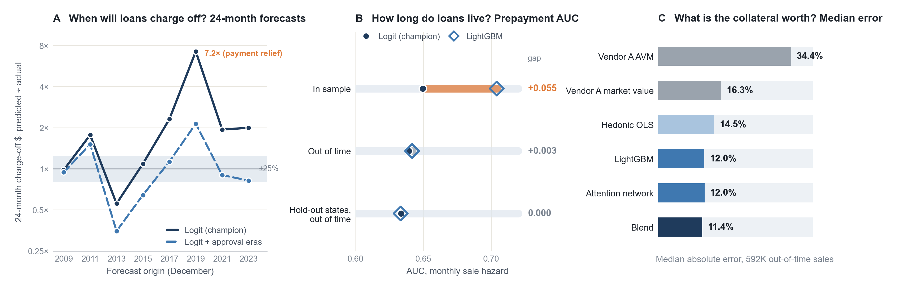
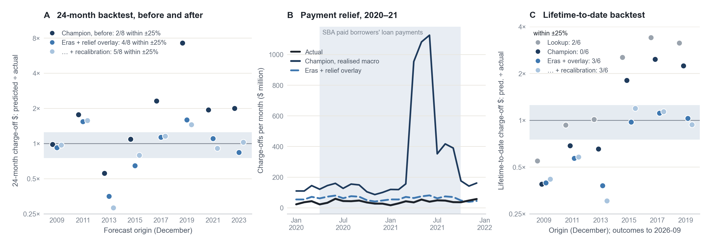
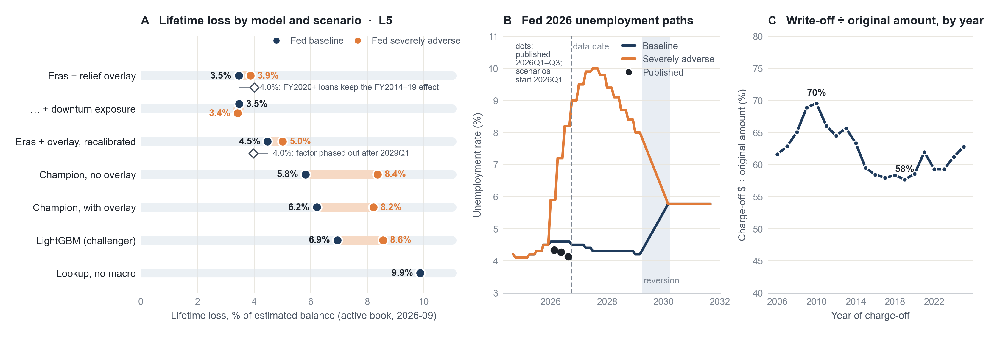
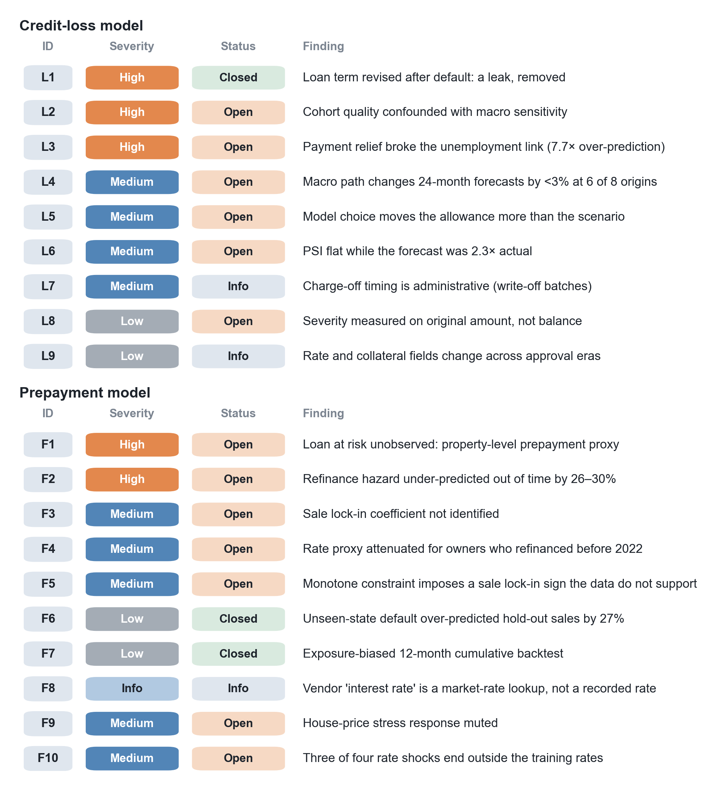

# Ranking survives, levels do not: validating the three inputs of a lifetime loss estimate

[](https://github.com/lyz44git/prepayment-and-avm-model-validation/actions/workflows/tests.yml)

**A lifetime credit-loss estimate depends on three model inputs: when loans are written off and how much is lost, how
long they stay on the books, and what the collateral is worth. Building and reviewing one model for each, the same
pattern recurs: out of time the champion models keep most of their ability to rank risk (AUC down 0.01–0.07; the
flexible challengers lose more), but their levels fail whenever the period forecast differs from the one the data
come from. The failures trace to what the data record, to changes of
regime and to episodes the data never contain, more than to the choice of estimator. A validator's job is therefore to
find the assumptions that set the level, show how far they move it, and monitor the level against outcomes.**

## In 60 seconds

| Input | Study and data | What the review found | Decision and use limit |
|---|---|---|---|
| Loss timing and severity | Credit loss on public SBA 7(a) data: 919,479 loans, 52M loan-months, 2006–2026 | A loan-term field revised after default leaked the outcome (challenger AUC 0.935, 0.737 without it). The champion read safer post-crisis loans as a better economy and over-predicted 2020–26 charge-offs 2.8-fold. Three rounds of fixes, each with its rule fixed in advance, cut the error by a third to a half; none met its rules. | Research use only. Report lifetime loss as a range (3.4–4.4% of balance), not one number; not for 24-month forecasts. |
| Loan life | Prepayment hazard on licensed property records: 22.9M property-months, 2022–2025 | LightGBM's ranking edge vanished out of time, so the logit stayed champion. Refinances were under-predicted by 26–30%; three of four rate shocks left the training rates; a pre-registered remediation closed neither finding. | Sale side usable; refinance only with trailing recalibration; no house-price stress use. |
| Collateral value | Home-valuation models on licensed records: 2.4M arm's-length sales, 2022–2025 | One vendor AVM sat 32% below sale prices and another was anchored to the sale price. A challenger cut median error to 11.4% from 16.3% out of time; in unseen states it tied over all months and won only out of time. PSI stayed flat while error rose. | Vendor fields are not benchmarks; the challenger is a monitoring benchmark in the states it was trained on. |

## Why the levels fail

Each failure in the three studies falls into one of five causes. Only the last is a model error in the narrow sense,
and the tests were set on levels across regimes, which is a high bar.

| Cause | What it means | Where it shows up here | Would more data of the same kind fix it? |
|---|---|---|---|
| Measurement | A field does not record what its name says, or records it late | Loan term revised after default; charge-off is an administrative write-off that comes in batches; the vendor "interest rate" is a market-rate lookup; a vendor value anchored to the sale price; September 2026 payoffs not yet recorded | No; the field has to be audited, dropped or redefined |
| Regime change | The process generating the data changed between fit and forecast | Safer loans after the crisis; SBA paid borrowers' loans in 2020–21; a rate cut after a period of rising rates; vendor values of a 2022 vintage | No; it needs an explicit assumption, an overlay or a refit after the change |
| Missing support | The data never contain the episode the forecast needs, or cannot separate two effects | One downturn in 2006–2019; no refinancing incentive in 2022–24 training months; almost no loans above 80% LTV; era, age and calendar time collinear | Only with time, or with variation the data lack (more cycles, state-level macro, loan-level rates) |
| Evaluation design | The test, not the model, produces the result | Price tiers sorted on the realised price; an unseen-state comparison that mixes vendor vintages; overlapping backtest origins | Fixed by redesigning the test, which this repository does where it can |
| Specification | The model is wrong about something the data could show | The champion read cohort quality as macro sensitivity; no unobserved heterogeneity or common frailty factor | Yes, partly: approval-era effects halve the unemployment coefficient and cut the error by a third to a half |

The same pattern appears in the literature. A default model estimated in one lending regime fails systematically in
another (Rajan, Seru and Vig 2015); loan quality moves by origination vintage after controlling for observables
(Demyanyk and Van Hemert 2011); defaults cluster beyond what observable covariates explain (Das, Duffie, Kapadia and
Saita 2007; Duffie, Eckner, Horel and Saita 2009); and the prepayment response to a rate cut depends on how many
borrowers the past rate path left in the money (Berger, Milbradt, Tourre and Vavra 2021). Full references:
[docs/references.md](docs/references.md).

**Scope.** Public SBA loan records for credit loss; licensed property, deed, lien and household records for prepayment
and valuation (prepayment proxied by home sales and new first liens). None of it is bank, servicer or bureau data, and
the validation is self-administered, so it is not independent in the SR 11-7 sense. The three studies use two datasets
and are reviewed separately, not as one pipeline: in the one allowance actually computed (SBA), loan life comes from
the SBA payoff hazard and collateral does not enter, because severity is measured on the original amount. The
prepayment and valuation studies show how those two inputs would be validated for mortgage collateral. Numbers are
read from aggregate tables in `reports/`; the headline ones are checked by tests.



**Figure 1. One headline result for each input.**
<details><summary>Notes</summary>

Panel A: predicted ÷ actual charge-off dollars over the 24 months after each December origin (2009–2023) for the book of SBA 7(a) loans at risk, from a logit refitted on the data to that date with the realised macro path; the shaded band is ±25% (0.75–1.25), the pass band fixed before the run. Panel B: AUC of the monthly sale hazard for the prepayment logit (champion) and monotone LightGBM (challenger) in the training months, out of time and in hold-out states out of time; the number on the right is LightGBM minus logit. Panel C: median absolute error of two vendor value fields, the hedonic baseline and the challengers, each on the out-of-time sales it covers (591,687 in all).
</details>

## 1. Credit loss: the champion confused safer loans with a better economy.


**Figure 2. What the data record, and what the champion gets wrong.**
<details><summary>Notes</summary>

Panel A: by final loan status, the share of SBA 7(a) term loans whose recorded term is not a whole number of years; loans cancelled before disbursement keep their approved terms. Panel B: AUC of the monthly charge-off hazard for the logit and LightGBM, in sample (2006–2019) and out of time (2020-01 to 2026-09), with the revised term among the features (first fit) and without it. Panel C: predicted ÷ actual charge-offs of the champion logit by approval fiscal year, in sample.
</details>

**The data first.** 90% of charged-off loans carry a term that is not a whole number of years, against 10% of loans
cancelled before disbursement: the term is revised after trouble. With it, LightGBM reached an out-of-time AUC of
0.935; without it, 0.737. Charge-off is an administrative write-off about four years after disbursement, partly in
batches ([report, §2](docs/credit_loss_cecl_validation.md#2-what-the-data-record)).

**The champion.** LightGBM ranks loans better than the logit (out-of-time AUC 0.737 against 0.681) but failed the
calibration part of the pre-set replacement rule, so the logit stayed champion by default; it is no better calibrated
(2.13 against 1.66 times actual in the validation months). Out of time it over-predicts 2.8-fold: 1.75-fold outside the
2020–21 payment-relief months, 6.7-fold inside them.

**Why.** The champion under-predicts loans approved FY2006–07 (0.77, 0.69) and over-predicts every cohort from FY2009
to FY2018 (1.28–2.34). Adding approval-era effects halves its unemployment coefficient, from 0.215 to 0.103: about half
of what it read as sensitivity to the economy was the quality of the loans on the books when unemployment rose. Era,
age and calendar time are collinear and the era cut-points were set after seeing this table, so the size of the split
is one reading among several ([report, §5](docs/credit_loss_cecl_validation.md#5-did-the-loans-change-vintage-not-only-the-economy)).

**In the literature.** The champion is a cause-specific discrete-time hazard estimated as a logit, as in Shumway (2001)
and Campbell, Hilscher and Szilagyi (2008). Its failure is the mechanism of Rajan, Seru and Vig (2015) with the
opposite sign: there, a model fitted before securitization changed lenders' incentives under-predicted later
defaults; here, a model whose macro term was learned from crisis-era cohorts over-predicts losses on the safer cohorts
that followed. The approval-era effects play the role of the vintage effects in Demyanyk and Van Hemert (2011).
Machine learning improves default prediction in Fuster, Goldsmith-Pinkham, Ramadorai and Walther (2022); here
LightGBM ranks better but is no better calibrated, so it does not fix the level.

<sub><b>Methods.</b> SBA 7(a) term loans as of 2026-09-30: 919,479 loans and 52,141,481 loan-months at risk in 2006-01 to 2026-09. Cause-specific discrete-time hazards for charge-off and payoff on all events and 5% of other months, intercept corrected; fit 2006–2017, validation 2018–2019, out of time 2020-01 to 2026-09; nine hold-out states. Plan hashed before fitting; six documented deviations (<a href="docs/credit_loss_deviations.md">deviations</a>).</sub>

## 2. Fixes cut the error by a third to a half; what remains is write-off timing, policy and a single cycle, not the estimator.



**Figure 3. Backtests before and after remediation.**
<details><summary>Notes</summary>

Panel A: predicted ÷ actual 24-month charge-off dollars at eight December origins for the champion before remediation and for the logit with approval-era effects and the relief overlay, with and without trailing recalibration, each refitted on data to the origin and run with the realised macro path; the band is ±25% (0.75–1.25). Panel B: monthly charge-off dollars in 2020–2021 against forecasts made at December 2019; the shaded months are those in which SBA made borrowers' loan payments. Panel C: predicted ÷ actual charge-off dollars of each origin's book from the origin to 2026-09, for the lookup, the champion and the three candidates; the pre-set rule was five of six origins within ±25%.
</details>

The realised macro path barely moves 24-month forecasts (less than 3% at six of eight origins, five in a corrected
rerun, partly because the 12-month lag fixes the first year's inputs), and in 2020–21 it made them worse: from December 2019 the champion
predicted 7.7 times the charge-offs of April 2020 to December 2021, when unemployment rose nine points while SBA made
borrowers' payments.

Three rounds of fixes followed, each with its rule written before it ran: approval-era effects, trailing
recalibration, a downturn-exposure term and a documented relief overlay. Outside the relief months, out-of-time
predicted ÷ actual moved from 1.75 to 0.72–0.83 across the candidates, and the typical 24-month error fell by a third
(by half including the 2019 origin, where the overlay uses hindsight). No candidate met both rules: the best backtest
reached five of eight origins against six required. A lifetime-to-date test also failed (best four of six against
five); the three candidates are within ±25% only at the three latest origins, with or without the overlay. Two
further limits: the era model under-predicts the cohorts that make up today's book (FY2014–19 at 0.70–0.82 out of
time), and each round was designed after seeing the last, so the best-of-candidates figures are optimistic
([report, §11](docs/credit_loss_cecl_validation.md#11-remediation-three-rounds-each-with-its-rule-written-before-it-ran)).
Checks added at review ([report, §14](docs/credit_loss_cecl_validation.md#14-robustness-checks-added-at-review-2026-11-18))
leave these results in place: a corrected backtest script moves no pass count, month-clustered standard errors keep
the unemployment and era effects significant (the drop in the unemployment coefficient is 0.112, 95% interval
0.095–0.166), and an outcome trigger on trailing predicted ÷ actual would have fired before five of the six misses with
no false alarm, where a PSI computed without future data caught two.

**In the literature.** The write-off batches and the cohort shifts are the kind of common, unobserved driver that
Das, Duffie, Kapadia and Saita (2007) and Duffie, Eckner, Horel and Saita (2009) find in corporate defaults; a frailty
term is not modelled here and is the natural next step. The relief overlay is a policy adjustment that no estimated
relationship can supply on its own, the point of Lucas (1976). Each round's rule was fixed before it ran, as Harvey
(2017) urges, but each round was designed after seeing the last, which is the forking-paths risk he describes.

<sub><b>Methods.</b> Origins every December from 2009 to 2023; models refitted on all data to each origin; each loan projected month by month with both hazards and the severity model. Lifetime test: the book at each origin projected to 2026-09 (81 to 201 months of outcomes).</sub>

## 3. Which model you choose still moves the allowance more than the Fed's severe scenario does.



**Figure 4. Lifetime expected loss of the active book at 2026-09-30.**
<details><summary>Notes</summary>

Panel A: lifetime expected loss as a share of the estimated outstanding balance of the 232,292 loans active at 2026-09-30 ($128bn) under the Federal Reserve's 2026 baseline and severely adverse scenarios, for the three candidates and the champion (all with the relief overlay in their estimation history), LightGBM, and the lookup, which has no macro terms. Panel B: unemployment in the two scenarios, applied from their 2026Q1 start (dots: published values for 2026Q1–Q3), with straight-line reversion to the 2006–2025 average after 2029Q1. Panel C: charge-off dollars over original loan amounts by year of charge-off.
</details>

The candidates put lifetime loss (gross write-offs, before recoveries) at 3.4% to 4.4% of balance under the Fed
baseline, against 6.0% for the champion with the same overlay and 5.7% without it. The severely adverse scenario adds
0.1 to 0.8 points to the candidates and 2.5 to the champion, so the choice of model moves the estimate more than the
scenario does. The lower end assumes the era model's under-prediction of recent cohorts does not persist; the upper
end applies the recent shortfall. Severity barely moves with the cycle, so the scenario works through the hazards:
about two-thirds through the charge-off hazard and one-third through slower payoffs for the era model. Two
assumptions about recent cohorts move the range more than the scenario or the reversion speed: giving loans approved
since FY2020 (80% of the book) the FY2014–19 cohort effect raises the low end to 3.9%, and phasing out the recalibration
factor after the scenario lowers the high end to 3.9%. The usable statement is a range with its reasons ([report, §9](docs/credit_loss_cecl_validation.md#9-lifetime-expected-loss-at-2026-09-30)).

<sub><b>Methods.</b> Final models fitted on 2006-01 to 2026-09. Horizon: each loan's remaining recorded term (sensitivity: 24 more months, +0.25 to +0.47 points). Expected loss = survival × charge-off hazard × severity × original amount; the lender's retained share is pro rata to the unguaranteed part. The scenarios start in 2026Q1, three quarters before the data date (finding L12).</sub>

## 4. Prepayment: the model never saw a refinancing incentive, so it could not forecast one.


**Figure 5. Calibration and rate sensitivity of the prepayment champion.**
<details><summary>Notes</summary>

Panel A: predicted ÷ actual monthly hazard of the logit by split, for sales and for refinances or new first liens. Panel B: predicted and actual share of 482,037 homes that sell or take a new first lien within 12 months of July 2024, by decile of predicted risk. Panel C: odds ratio of the monthly hazard per percentage point by which the market rate exceeds the rate when the home was bought (the lock-in gap), with 95% confidence intervals, for refinancing under six specifications and for sales under two.
</details>

LightGBM ranked sales far better in the training months (AUC 0.704 against 0.650); out of time the gap closed (0.642
against 0.639) and in hold-out states it was gone, so the interpretable logit is champion
([report, §5](docs/prepayment_model_development_and_validation.md#5-results)). Its pool-CPR tracking is not
distinctive (correlation 0.90, the same as a seasonal-naive forecast), so its value is in loan-level ranking and the
stress response. Sales are calibrated in every split; refinancing is under-predicted by 30% out of time, and the gap
was already 20% before the September 2024 rate dip. Refinancing falls as the lock-in gap widens (odds ratio 0.89 per
point; 0.87–0.93 in five of six specifications, 0.98 and not significant with a cohort-rate proxy). Clustering by month as well as county leaves that interval unchanged; the market-rate level stays significant with standard errors about twice as wide.

**Why, and in the literature.** The training months (2022-05 to 2024-06) were a period of rising rates in which almost
no owner had an incentive to refinance; the September 2024 dip created one. Berger, Milbradt, Tourre and Vavra (2021)
show that the refinancing response to a rate cut depends on the distribution of incentives the past rate path left
behind, and Andersen, Campbell, Nielsen and Ramadorai (2020) show that households act on an incentive with delay that
differs across households. A model fitted when no one was in the money cannot learn either. The design follows the
competing-risk tradition of Deng, Quigley and Van Order (2000) and the empirical prepayment function of Schwartz and
Torous (1989), but without the borrower heterogeneity that Stanton (1995) and Deng et al. build in; adding it, with
loan-level rates, is what would be needed to close finding F2.

<sub><b>Methods.</b> A 4% random sample of 642,445 at-risk owner-occupied homes gives 22,885,356 property-months (2022-05 to 2025-06). Cause-specific discrete-time logit hazards for sale and for refinance or new first lien, on all events and 10% of non-events with King–Zeng correction. Training in 41 jurisdictions to 2024-06; out of time 2024-07 to 2025-06; nine hold-out states fixed in advance.</sub>

## 5. Under stress the prepayment model is usable only inside its training rates, and two findings stayed open after remediation.


**Figure 6. Stress tests on 564,732 homes over 24 months.**
<details><summary>Notes</summary>

Panel A: change in average 24-month CPR against a base with rates flat at the June 2025 level (6.82%), for the logit and LightGBM, under rate shocks phased in over six months and under the realised rate path; shaded rows end outside the 5.22–7.62% range of mortgage rates in the training months. Panel B: change under house-price shocks for the published logit (two equity terms) and the remediated one (estimated LTV only); the dashed line is the closure bar fixed in the remediation plan. Panel C: share of training property-months by estimated loan-to-value band.
</details>


**Figure 7. The refinance shortfall and what reduced the pool error.**
<details><summary>Notes</summary>

Panel A: predicted ÷ actual monthly refinance or new-lien hazard out of time for the remediated logit, fixed at June 2024 and re-estimated each month on data to t − 2; the band is the closure rule fixed in the plan. Panel B: mean absolute error of monthly pool CPR out of time, in percentage points, for six forecasts, including last month's CPR carried forward.
</details>

A 200 bp cut raises the pool's prepayment rate by 1.25 points and a 200 bp rise lowers it by 0.85; three of the four
shocks end outside the training rates, where LightGBM is flat by construction (−0.18 at +200 bp). A 10% fall in house
prices barely moves prepayment (−0.008 points). A remediation plan with closure rules was hashed before any refit
([plan](docs/prepayment_model_remediation_plan.md)). Estimated LTV as the only equity term doubles the house-price
response but stays far below the bar, because almost no training months are above 80% LTV; re-estimating every month
leaves refinance predicted ÷ actual at 0.71. **Neither finding closed.** Trailing three-month recalibration lowers the
pool error from 0.43 to 0.30 points and is kept as the monitoring control; carrying last month's CPR forward already
gets to 0.34, so most of the gain comes from using recent actuals.

<sub><b>Methods.</b> Seven rate scenarios plus two house-price paths; homes rolled forward month by month; count-based CPR. Remediation: reproduction of the published model, five candidates chosen on training months only, one scoring of the out-of-time window, walk-forward refits on data to t − 2.</sub>

## 6. Collateral: the vendor values were the weak link.


**Figure 8. Vendor values, the challenger in unseen states, and the monitoring back-test.**
<details><summary>Notes</summary>

Panel A: median ratio of each vendor value field to the recorded sale price, by quarter of sale, for 2.4 million arm's-length resales. Panel B: median absolute error of the challenger blend and of the best usable vendor value out of time (2024-07 to 2025-08) and in nine states the challengers never saw. Panel C: monthly median error of the LightGBM challenger out of time, and the largest population stability index of its predictions and of inputs not expected to shift in any month.
</details>

Lenders use vendor home values as collateral and verification inputs. One vendor AVM sits 32% below sale prices
(median error 34.4%); another vendor's "estimated value" is anchored to the sale it should predict, which is target
leakage, the same kind of finding as the revised loan term in section 1
([report](docs/avm_champion_challenger_validation.md#2-vendor-due-diligence-champions)). Out of time the challenger
blend has a median error of 11.4% against 16.3% for the best usable vendor (county-cluster bootstrap difference −5.4
points, 95% CI −6.7 to −4.4); in nine states it never saw it does no better (12.2% against 12.0%). Its 80% intervals
cover 77.5% out of time. Over a 14-month back-test, PSI of the predictions and stable inputs stayed at or below 0.012
while the LightGBM challenger's median error rose from 11.1% to 12.9%; an outcome trigger would have fired in May 2025.
Two results did not survive review: the unseen-state tie splits by period (the vendor was better while its 2022 values
were current, the challenger out of time, 12.8% against 18.5%), and sorting sales into price tiers by a value known
before the sale removes most of the vendor AVM's minority-share gap and of the extreme bottom-decile error
([report, §9](docs/avm_champion_challenger_validation.md#9-robustness-checks-added-at-review-2026-11-18)). The LightGBM challenger is
packaged as a FastAPI scoring service with a PSI endpoint and 19 tests ([`service/`](service)).

**Why.** The vendor failures are measurement problems in third-party data: a value fixed years before the sale, and a
value that already contains the sale price. The two results that did not survive are evaluation-design problems: a
comparison that mixed vendor vintages, and price tiers that sort on the outcome. Studies of assessment gaps, such as
Avenancio-León and Howard (2022) for property taxes, depend on how values are compared with prices; here the measured
gap of a vendor AVM moves from −0.091 to −0.010 log points, no longer significant, when tiers are built on a value
known before the sale.

<sub><b>Methods.</b> 2,418,184 arm's-length resales (2022-05 to 2025-08, 49 states and DC); training to 2024-03, calibration 2024-04 to 06. Hedonic OLS, LightGBM on 33 features, a PyTorch neighbour-attention network over the 32 nearest comparable sales, and their equal-weight blend. Split-conformal intervals; county-cluster bootstrap; PSI against the training window, excluding six inputs that shift by design.</sub>

## 7. Thirty-three findings, twenty-six still open: the use limits.



**Figure 9. Findings logs of the three studies.** Severity and status are read from the findings logs ([credit loss, §12](docs/credit_loss_cecl_validation.md#12-findings-log); [prepayment, §7](docs/prepayment_model_development_and_validation.md#7-findings-log); [valuation, §8](docs/avm_champion_challenger_validation.md#8-findings-log-and-use-limits)), which give the evidence and remediation for each; the labels are shortened.

What follows for use:

- **Report the allowance as a range across models**, with the cohort effect stated, and fit it on at least one full
  credit cycle (credit loss L2, L5, L10, L14).
- **Overlay or switch off macro terms when policy changes borrowers' payments**, as in 2020–21 (L3).
- **Monitor outcomes, not only drift.** In the loss and the valuation studies the drift statistics missed errors that
  an outcome trigger would have caught (L6, V5).
- **Check that every field was known at decision time.** A revised loan term and a vendor value anchored to the sale
  price both looked like strong predictors (L1, V2).
- **Keep stress use inside the training range**, and do not use the prepayment model for house-price stress (F9, F10).

## What this shows, and what it does not

- **It shows** that in three different loss-model inputs the level, not the ranking, is what fails out of time; that
  the failures trace mostly to measurement, regime change and missing support; that a model assumption about recent
  cohorts moves a CECL-style lifetime loss more than the Fed's severely adverse scenario; that a field revised after the
  outcome (the SBA loan term) can pass for a strong predictor; and that an outcome trigger caught errors that input
  drift statistics missed in both the credit-loss and the valuation back-tests.
- **It does not show** that any model here is fit for a bank allowance. The validation is self-administered; the data
  are public SBA records and licensed property records, not a lender's portfolio; prepayment is proxied by sales and
  new liens; the credit-loss history contains one downturn; backtest origins overlap, so they are not independent
  tests; the remediation rounds were designed adaptively and reused the same out-of-time window; and the inference
  clusters by month only.
- **It does not claim new economics.** The mechanisms are known (see above); the contribution is to show them in a
  validation of each input, with the tests, failures and use limits written down.

## How the three studies compare

| | Credit loss | Prepayment | Home valuation |
|---|---|---|---|
| Out of time | Fit 2006–2019 (validation 2018–19), scored 2020-01 to 2026-09; the window was reused across three remediation rounds | Train to 2024-06, scored 2024-07 to 2025-06; the house-price index includes out-of-time sales | Train to 2024-03, calibration 2024-04 to 06, scored 2024-07 to 2025-08; index frozen at 2024-06 |
| Geography | Nine hold-out states, never fitted | Nine hold-out states; spatial and spatial × out-of-time cells | Nine hold-out states, all months |
| Pass rule | Backtests within ±25% (0.75–1.25); out of time and monitoring trigger 0.80–1.25; champion replacement needs 0.90–1.10 | Remediation closure: refinance predicted ÷ actual ≥ 0.85 at fixed origin, 0.90–1.10 re-estimated | None set in advance |
| Adoption | Nothing adopted outside the rules | Champion by judgement; remediated spec proposed outside the plan and labelled as such | No adoption decision |
| Pre-registration | Plan and each round hashed before running (round hashes are of private drafts) | Remediation plan hashed before refitting | None |

References for every work cited: [docs/references.md](docs/references.md).

## The studies

| Study | Question | Report | Code |
|---|---|---|---|
| Credit loss and lifetime expected loss | When are small-business loans written off, how much is lost, and does a scenario-based lifetime loss estimate hold up out of time? | [validation report](docs/credit_loss_cecl_validation.md), [plan](docs/credit_loss_plan.md), [deviations](docs/credit_loss_deviations.md) | `scripts/40`–`47` |
| Prepayment hazard model | How fast do homes terminate their mortgage through sale or refinance in 2022–25, and how far can a model of it be trusted out of time, out of state and under stress? | [development and validation](docs/prepayment_model_development_and_validation.md) | `scripts/04`–`09`, `16`, `17`, `21`, `22` |
| Remediation of two prepayment findings | Can the two most consequential open findings be closed under rules fixed before any refit? | [plan](docs/prepayment_model_remediation_plan.md); §9 of the report | `scripts/31`–`33` |
| Home-valuation models | How accurate, current and even-handed are vendor home values against recorded sale prices, and can a challenger beat them out of time and out of geography? | [champion–challenger validation](docs/avm_champion_challenger_validation.md) | `scripts/10`–`15`, `23`, `24`; `service/` |

## Data sources and terms

| Data | Use | Terms |
|---|---|---|
| SBA 7(a) FOIA loan files as of 2026-09-30 (FY2000 onward) | credit-loss study | U.S. Government Works. Downloaded by `scripts/00_download_sba.sh` and checked against `reports/p3/SHA256SUMS.txt`; SBA replaces the files each quarter. |
| Federal Reserve 2026 supervisory scenarios (historic, baseline, severely adverse) | macro inputs of the credit-loss study | Public; same script. |
| Licensed property, deed, lien and household records from three commercial vendors (Vendor A, B and C) | prepayment and valuation studies | Obtained for academic research under a data-use agreement. **No data are published and none can be redistributed**; only code and aggregate results are shown, for research use. The vendors are not named because the studies report findings about their products. |
| Freddie Mac PMMS, 10-year Treasury, unemployment, FHFA California HPI (FRED); Census tract attributes | prepayment and valuation studies | Public; `scripts/00_download_fred.sh`. |

**Research use only, not commercial.** No record-level data are in this repository. `reports/` holds aggregate tables only (no identifiers, no table with
more than 2,000 rows; a test checks this). The SBA files name borrowers; their names and addresses are dropped when
the loan table is built and never leave the working folder. The licensed records were modelled on working tables
without names or street addresses; the step that builds them is not published.

## Repository layout

```
docs/       the three validation reports, the two analysis plans, the credit-loss deviations and the references
reports/    aggregate tables and figures behind every number (p3 credit loss, p1 prepayment, p1/remediation, p2 valuation)
figures/    Figures 1 to 9, and the script and shared style that draw them from reports/
scripts/    numbered pipeline: 04-26 prepayment and valuation, 31-35 remediation and checks, 40-51 credit loss
src/mval/   shared code: hazard designs, metrics, amortization, macro inputs, fairness, valuation statistics
service/    FastAPI scoring service with PSI monitoring, and its tests
tests/      tests that run anywhere (CI)
```

## Setup

```bash
python -m venv .venv && source .venv/bin/activate
pip install -r service/requirements.txt scipy statsmodels matplotlib
python figures/make_figures.py
```

This is enough for the tests and Figures 1 to 9. The credit-loss study reruns end to end from public data:
`scripts/00_download_sba.sh`, then scripts 40 to 47 in order (`requirements.txt` lists the packages; about two hours on
a 32-core machine). Scripts 04–17, 21–24 and 31–32 re-estimate the prepayment and valuation studies from the
licensed working tables (`MVAL_WORK`) and cannot run from a clone; they are published so the method can be read and
reviewed line by line.

## Tests

```bash
pytest tests service/tests -q
```

The tests need none of the data. They check the headline numbers in this README and the three reports against
the tables in `reports/`, the hashes of the two analysis plans, that the hazard estimator recovers known coefficients
on simulated data, the amortization, macro-reversion and metric arithmetic, that no table in `reports/` is large or
carries an identifier column, and the scoring service on a fixture model. One service test needs the real model and
is skipped in CI. They run on every push (see the badge above).

## License

Code in `src/`, `scripts/`, `figures/`, `service/` and `tests/` is released under the MIT License (see `LICENSE`).
Files in `reports/p1/`, `reports/p2/` and the prepayment and valuation reports are derived from licensed data and are
shared for non-commercial research and review only; the credit-loss tables derive from public SBA data.

## Notes

Developed with an AI-assisted coding workflow. The research questions, analysis plans and interpretation of results
were led by the author. All results are reproducible from the scripts, the public data and the licensed working
tables; the aggregate tables behind every number are in `reports/`.
