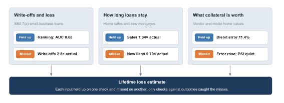
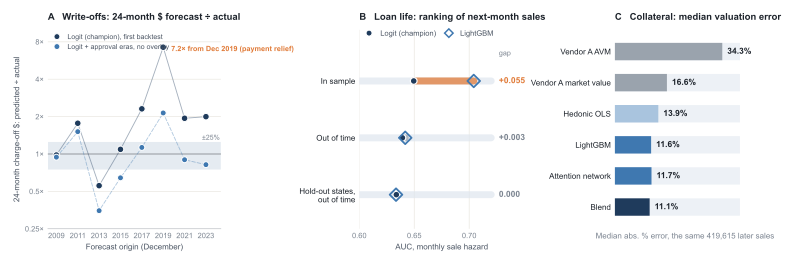
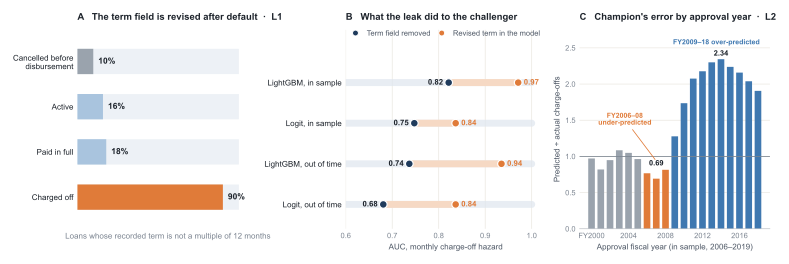
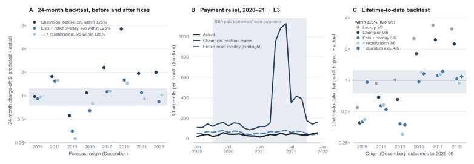
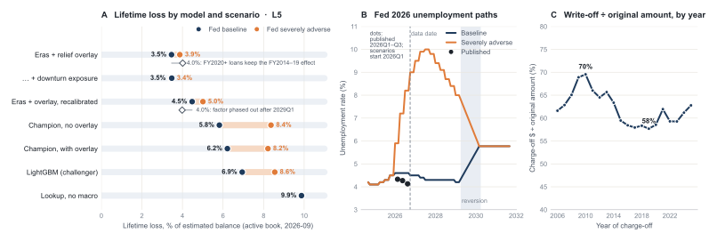
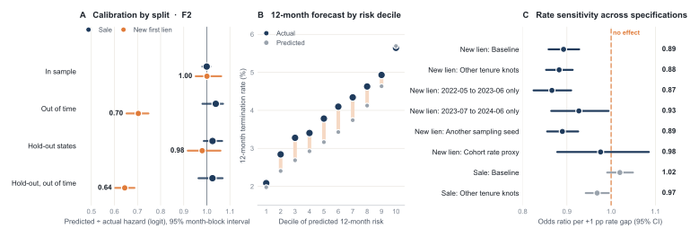
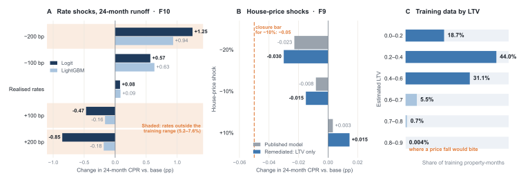
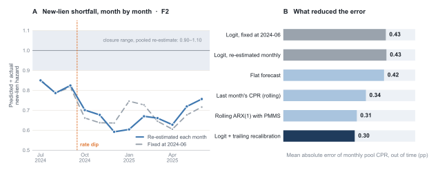
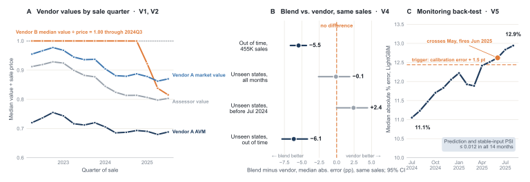
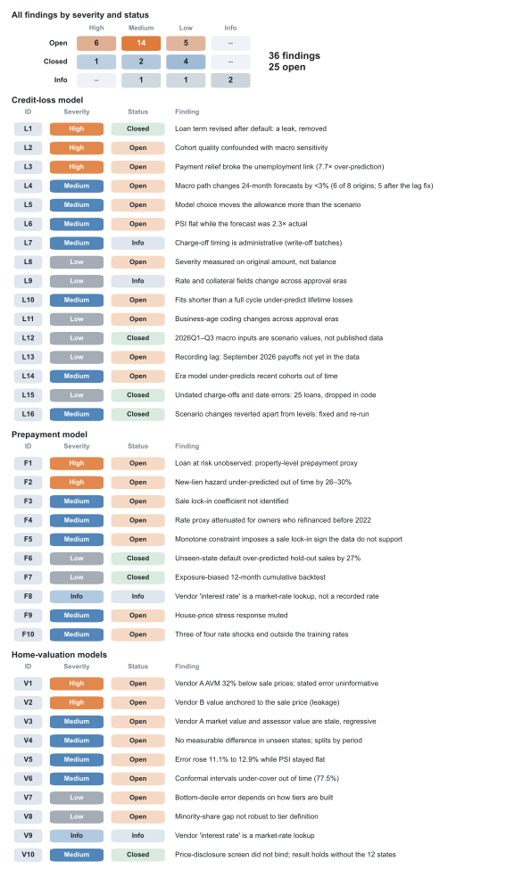

# Ranked right, booked wrong: validating the three inputs of a lifetime loss estimate

[](https://github.com/lyz44git/prepayment-and-avm-model-validation/actions/workflows/tests.yml)

<sub>Latest version · results as of 2026-11-19 · [details](#latest-version)</sub>

**The small-business loss model still told riskier loans from safer ones in the later years, yet it predicted 2.8
write-offs for every one SBA recorded. The same thing happened, in different forms, in the other two inputs to a
lifetime loss estimate: how long loans stay on the books and what the collateral is worth. In each case a model that
ranks well missed a level that a bank would have to book or monitor, and only a check against outcomes caught it.**

A bank sets money aside for the loans it expects to lose, and for that it needs three estimates: when borrowers stop
paying and how much is lost, how long each loan stays on the books, and what any collateral is worth. This repository
builds a model for each and tests it on later years the models never saw. The small-business model picked out the
riskier loans but over-predicted write-offs; a mortgage model came close on home sales and missed many new mortgages;
a home-value model grew less accurate while the usual monitoring statistics stayed quiet.

<picture>
  <source media="(prefers-color-scheme: dark)" srcset="figures/figure0-dark.svg">
  
</picture>

## Summary

| Decision a bank needs | Study and data | What the later period showed | Use supported |
|---|---|---|---|
| How many small-business loans will be written off, and for how much? | Credit loss on public SBA 7(a) data: 919,479 loans, 52M loan-months, 2006–2026 | A loan-term field revised after default leaked the outcome (challenger AUC 0.935, 0.737 without it). The logit champion predicted 2.8 times the recorded charge-off count in 2020-01 to 2026-09, and 1.75 times outside April 2020 to December 2021, when SBA made borrowers' payments. Three rounds of fixes, each with its rule fixed in advance, cut the typical 24-month backtest error by a third to a half; none met its rules. | Research and benchmarking. Three revised models put gross lifetime write-offs of the active book at 3.5–4.5% of estimated balance under the Fed baseline; the range reflects model assumptions and is not a confidence interval. Not for 24-month forecasts. |
| How long will mortgages stay on the books? | Prepayment hazard on licensed property records: 22.9M property-months, 2022–2025 | The logit forecast about 1.04 sales per recorded sale; both models under-predicted new first liens by 26–30%. LightGBM's ranking edge vanished out of time, so the logit stayed champion. Three of four rate shocks ended outside the training rates. | Sales usable; new liens only with trailing recalibration, which still fails its accuracy rule; no house-price stress use. |
| Can a vendor home value serve as a benchmark? | Home-valuation models on licensed records: 2.4M arm's-length sales, 2022–2025 | One vendor AVM sat 32% below sale prices; another tracked the recorded sale price too closely to be a pre-sale value. A challenger blend had a median error of 11.4% against 16.3% for the best usable vendor on later sales; in nine unseen states, over all months, 12.2% against 12.0%. Its error rose while PSI stayed flat. | Vendor fields are not benchmarks. The blend is a monitoring benchmark in the states it was trained on. |

Only the SBA study computes a lifetime dollar loss, from the SBA loans' own payoff history and charge-off amounts.
The two housing studies use separate property records to show how a lender would validate the other two inputs for
mortgage collateral.

<details><summary><b>Technical summary</b></summary>

The SBA study fits cause-specific monthly logit hazards for charge-off and payoff on all events and 5% of other months
(intercept-corrected), a fractional-logit severity on the original amount, and a LightGBM challenger; fit 2006–2017,
validation 2018–2019, out of time 2020-01 to 2026-09, nine hold-out states. Out of time, charge-off AUC is 0.737 for
LightGBM and 0.681 for the logit, and both over-predict by more than two times. Remediation was pre-specified round by
round; the best candidates reached five of eight 24-month origins within ±25% (recalibrated model) and four of six
lifetime-to-date origins (downturn-exposure model), short of six and five. Lifetime loss of the 2026-09 active book
under the Fed 2026 scenarios is 3.5–4.5% of estimated balance across the three revised models, and the severely adverse scenario
moves each by −0.05 to +0.53 points, less than the choice of model. The mortgage study tests recorded sales and new first
liens as prepayment proxies, out of time, out of state and under rate shocks; the valuation study compares vendor
values and challengers on later sales, hold-out states and their intersection. Each study ends with the uses its model
supports, the inputs that were known only after the fact, and a log of findings with their status.
</details>

<details><summary><b>Glossary</b></summary>

| Term | Meaning |
|---|---|
| Monthly hazard | The chance of an event this month for a loan still open at the start of the month. |
| Competing risks | A loan that pays off today cannot be written off tomorrow, so the two exits are modelled together. |
| Charge-off (write-off) | The lender records a loan amount as a loss, often months or years after the borrower stopped paying. |
| Severity | In the SBA study, the share of the original loan amount written off when a charge-off happens. |
| Gross write-offs | Losses recorded before any later recoveries are subtracted; the dollar outcome of the SBA study. |
| Vintage or cohort | Loans approved in the same period, tracked as a group as they age. |
| Champion and challenger | The current model and a candidate tested against it. |
| AUC (ranking) | How often a loan that had the event got a higher score than one that did not; 0.5 is a coin flip. |
| Calibration (level) | Whether predicted counts or dollars match what happened, overall and within groups. |
| Predicted ÷ actual | The level check used throughout: 1 is right, 2 means twice what happened. |
| Out-of-time test | Fit on earlier records, then check predictions against a later period. |
| Backtest | Start at an earlier date, forecast for the loans open then, and compare with what was later recorded. |
| Lifetime expected credit loss (CECL) | The loss expected over the remaining life of the loans, allowing for repayments; the basis of a bank's allowance under US accounting. |
| Overlay | A documented judgement that changes a model's input or output, such as an adjustment for a payment-relief programme. |
| Prepayment proxy | A home sale or a new first mortgage, taken as evidence that the earlier loan ended. |
| CPR | The annualised share of a pool that prepays if this month's pace continued. |
| AVM | An automated valuation model: an estimate of a home's value from its attributes and nearby sales. |
| Median absolute percentage error | Sort the valuation errors as shares of the sale price and take the middle one. |
| PSI | Population stability index: how much the distribution of a score or input has moved from a reference period. |
| Percentage point (pp) | The difference between two percentages; 100 basis points make one percentage point. |
</details>

## Why the levels missed

A failure can have more than one cause, so each is listed under its main one, with the second in brackets where it
applies. Correct code and data are a precondition, not a cause; implementation issues found while maintaining the
studies are logged as findings and fixed (L15, L16, V10).

| Possible cause | Where it shows up here | How the reports tell it apart | Would more data of the same kind fix it? |
|---|---|---|---|
| Measurement: a field does not record what its name says, or records it late | Loan term revised after default; write-offs posted in batches; the vendor "interest rate" is a market-rate lookup; a vendor value that tracks the sale price; September 2026 payoffs not yet recorded; a purchase-cohort rate proxy that measures the refinancing incentive poorly | Compare the field across final outcomes or against an independent record; refit without it | No; the field has to be audited, dropped or redefined |
| Regime change: the process generating the data changed between fit and forecast | SBA paid borrowers' loans in 2020–21; safer loans after the crisis (also specification); vendor values of a 2022 vintage | Results with and without a documented overlay; the same comparison split by period | No; it needs an explicit assumption, an overlay or a refit after the change |
| Missing support: the data lack the episode the forecast needs, or cannot separate two effects | One downturn in 2006–2019; three of four rate shocks outside the training rates; almost no homes above 80% LTV; approval era, loan age and calendar time overlap | Count the training observations in the region the forecast needs | Only with time, or with variation the data lack (more cycles, state-level macro, loan-level rates) |
| Evaluation design: the test, not the model, produces the result | Price tiers sorted on the realised price; an unseen-state comparison that mixed vendor vintages; overlapping backtest origins | Change only the test: same homes with different tiers, same dates in both comparisons | Fixed by redesigning the test, as the reports do where they can |
| Specification: the model is wrong about something the data could show | Cohort quality absorbed by the macro term (also regime change); no frailty or borrower heterogeneity | Add the term and re-test out of time | Partly: approval-era effects halve the unemployment coefficient and cut the error by a third to a half |

**Each cause has precedents.** [Rajan, Seru, and Vig (2015)](https://doi.org/10.1016/j.jfineco.2014.09.012) show a default model failing after a change in how lenders used soft
information; the SBA forecasts also deteriorate across cohorts, though these data cannot say why the cohorts changed.
[Demyanyk and Van Hemert (2011)](https://doi.org/10.1093/rfs/hhp033) document vintage effects in loan quality; the approval-era effects here are a
conditional analogue. [Das et al. (2007)](https://doi.org/10.1111/j.1540-6261.2007.01202.x) and [Duffie et al. (2009)](https://doi.org/10.1111/j.1540-6261.2009.01495.x) find default
clustering beyond observable covariates; the SBA write-offs also cluster, but batched posting and a common shock to
borrowers cannot be separated in these records. [Berger et al. (2021)](https://doi.org/10.1257/aer.20181857) show that the past rate path
shapes the response to a rate cut, one candidate reading of the mortgage results. Full references:
[docs/references.md](docs/references.md).

**Scope.** Public SBA loan records for credit loss; licensed property, deed, lien and household records for prepayment
and valuation. None of it is bank, servicer or bureau data. The reports are
structured along the 2011 supervisory guidance on model risk management (SR 11-7), since replaced by SR 26-2 / OCC
Bulletin 2026-13 (April 2026). Numbers are read from aggregate tables in `reports/`, and the headline ones are
checked by tests.

<picture>
  <source media="(prefers-color-scheme: dark)" srcset="figures/figure1-dark.svg">
  
</picture>

**Figure 1. Each input missed in a different way: write-off forecasts were off by up to seven times, the sale-ranking
edge of the flexible model closed out of time, and valuation errors depended on the method.**
<details><summary>Notes</summary>

Panel A: predicted ÷ actual charge-off dollars over the 24 months after each December origin (2009–2023) for the book of SBA 7(a) loans at risk, from the first backtest (script 43; logits refitted on data to each origin, realised macro path, no relief overlay); the band is ±25% (0.75–1.25), the pass band fixed before the run, and 1 is a perfect forecast. The faint lines only guide the eye: the origins overlap and are not independent. Panel B: AUC of the monthly sale hazard for the prepayment logit (champion) and monotone LightGBM (challenger) in the training months, out of time and in hold-out states out of time; 0.5 is a random ranking, and the number on the right is LightGBM minus logit. Panel C: median absolute percentage error of two vendor value fields, the hedonic baseline and the challengers on the same 419,615 out-of-time sales, the ones every estimator covers (the text quotes each on its own coverage, 11.4% against 16.3%).
</details>

## 1. Credit loss: the champion ranked loans but over-predicted write-offs 2.8-fold.

<picture>
  <source media="(prefers-color-scheme: dark)" srcset="figures/figure2-dark.svg">
  
</picture>

**Figure 2. A field revised after default inflated the challenger's ranking, and the champion's errors line up with
approval year.**
<details><summary>Notes</summary>

Panel A: by final loan status, the share of SBA 7(a) term loans whose recorded term is not a whole number of years; loans cancelled before disbursement keep their approved terms. Panel B: AUC of the monthly charge-off hazard for the logit and LightGBM, in sample (2006–2019) and out of time (2020-01 to 2026-09), in the first fit (term-based features and censoring) and after the risk set was rebuilt without them. Panel C: predicted ÷ actual charge-off counts of the champion logit by approval fiscal year, in sample.
</details>

**A field that leaked the outcome.** 90% of charged-off loans carry a term that is not a whole number of years, against 10% of loans
cancelled before disbursement, which keep their approved terms: the term is revised after trouble. In the first fit,
with term-based features and censoring, LightGBM reached an out-of-time AUC of 0.935; after the risk set was rebuilt
without them, 0.737. On the same rows, adding the term features back alone restores the 0.935, so the leak is the
field itself. Charge-off is an administrative write-off about four years after disbursement, partly in
batches ([report, §2](docs/credit_loss_cecl_validation.md#2-what-the-data-record)).

**Ranking held; the level did not.** LightGBM ranks loans better than the logit (out-of-time AUC 0.737 against 0.681) but failed the
calibration part of the pre-set replacement rule, so the logit stayed champion by default, for interpretability, not
accuracy: both over-predict the validation months (logit 2.13, LightGBM 1.66 times actual) and the later years (2.79
and 2.43). Out of time the logit predicts 2.8 times the recorded charge-off count over 2020-01 to 2026-09: 1.75 times
outside April 2020 to December 2021, when SBA made borrowers' payments, and 6.7 times inside it. Ranked within each
month, so that differences in level between months do not count, the AUCs are 0.710 and 0.741.

**Cohorts, not only the economy.** The champion under-predicts loans approved FY2006–08 (0.77, 0.69, 0.82) and over-predicts every cohort from FY2009
to FY2018 (1.28–2.34). Adding approval-era effects halves its unemployment coefficient, from 0.215 to 0.103 log-odds per
point, so the forecast depends on how the model represents the loans on the books during the recession. With one
downturn and approval era, loan age and calendar time overlapping, the data cannot say how much of that change is
underwriting quality, and the era cut-points were set after seeing this table
([report, §5](docs/credit_loss_cecl_validation.md#5-did-the-loans-change-vintage-not-only-the-economy)).

**Model form.** The champion is a cause-specific discrete-time hazard estimated as a logit, as in [Shumway (2001)](https://doi.org/10.1086/209665)
and [Campbell, Hilscher, and Szilagyi (2008)](https://doi.org/10.1111/j.1540-6261.2008.01416.x), on a case-control sample with the intercept correction of [King and Zeng
(2001)](https://doi.org/10.1093/oxfordjournals.pan.a004868). Machine learning improves default prediction in [Fuster et al. (2022)](https://doi.org/10.1111/jofi.13090); here
LightGBM ranks better but is no better calibrated out of time, so it does not fix the level.

<sub><b>Methods.</b> SBA 7(a) term loans as of 2026-09-30: 919,479 loans and 52,141,481 loan-months at risk in 2006-01 to 2026-09. Cause-specific discrete-time hazards for charge-off and payoff on all events and 5% of other months, intercept corrected; fit 2006–2017, validation 2018–2019, out of time 2020-01 to 2026-09; nine hold-out states. Plan hashed before fitting; six documented deviations (<a href="docs/credit_loss_deviations.md">deviations</a>).</sub>

## 2. Three rounds of fixes cut the error by a third to a half, but none met its pre-set rule.

<picture>
  <source media="(prefers-color-scheme: dark)" srcset="figures/figure3-dark.svg">
  
</picture>

**Figure 3. Different fixes came closest on the two backtests, and both fell short.**
<details><summary>Notes</summary>

Panel A: predicted ÷ actual 24-month charge-off dollars at eight December origins for the champion before remediation (first backtest) and for the logit with approval-era effects and the relief overlay, with and without trailing recalibration, each refitted on data to the origin and run with the realised macro path; the band is ±25% (0.75–1.25). Panel B: monthly charge-off dollars in 2020–2021 against forecasts made at December 2019; the shaded months are those in which SBA made borrowers' loan payments, and the relief overlay is a retrospective policy adjustment that a forecaster in 2019 could not have made. Panel C: predicted ÷ actual charge-off dollars of each origin's book from the origin to 2026-09 (losses to date, not over each loan's full life), for the lookup, the champion and the three candidates; the pre-set rule was five of six origins within ±25%.
</details>

The realised macro path barely moves 24-month forecasts (less than 3% at six of eight origins, five with a lag fix in
the payoff hazard, partly because the 12-month lag fixes the first year's inputs), and in 2020–21 it made them worse: from
December 2019 the champion predicted 7.7 times the charge-offs of April 2020 to December 2021 (7.2 times its
24-month dollars, Figure 1), when unemployment jumped
while SBA made borrowers' payments.

Three rounds of fixes followed, each with its rule written before it ran: approval-era effects, trailing
recalibration, a downturn-exposure term and a documented relief overlay. Outside the relief months, out-of-time
predicted ÷ actual moved from 1.75 to 0.72–0.83 across the candidates (some now under-predict), and the typical
24-month error fell by a third (by half including the 2019 origin, where the overlay uses hindsight). No candidate met
both rules: the best 24-month backtest reached five of eight origins against six required, and a lifetime-to-date
test, with a different model coming closest, reached four of six against five. Two further limits: the era model
under-predicts the cohorts that make up today's book (FY2014–19 at 0.70–0.82 out of time), and each round was designed
after seeing the last, so the best-of-candidates figures are optimistic
([report, §11](docs/credit_loss_cecl_validation.md#11-remediation-three-rounds-each-with-its-rule-written-before-it-ran)).
The backtests are retrospective: they apply a fixed specification to the realised, revised macro history, which is
not the same as a forecast made at each origin. Choosing the macro lag at each origin from the data available then
does not help (no model gains an origin; at 2009, with two years to fit on, the choice is unstable), so the fixed lag
does not explain the failure to meet the rule. Robustness checks
([report, §14](docs/credit_loss_cecl_validation.md#14-robustness-checks)) leave these
results in place: fixing the payoff lag in the backtest moves no pass count under the realised macro path, month-clustered
standard errors keep the unemployment and era effects significant (the drop in the unemployment coefficient is 0.112,
95% interval 0.095–0.166; allowing neighbouring months to be correlated widens it to 0.036–0.173 and puts the era
model's unemployment term at the edge of significance, z ≈ 2), rebuilding every table with the input-date checks moves
no pass count, and an outcome trigger on trailing predicted ÷ actual counts fired before five of the six
misses with no false alarm, where a PSI computed without future data caught two. With eight overlapping origins these
counts describe the back-test; they are not a measured sensitivity and specificity.

**Policy, and how the fixes were designed.** The 2020–21 relief shows the forecast risk when policy changes loan payments directly, the
concern of [Lucas (1976)](https://doi.org/10.1016/S0167-2231(76)80003-6); the size of the overlay is a modelling judgement, not an estimate. Each round's rule was fixed
before it ran, in the spirit of the transparency [Harvey (2017)](https://doi.org/10.1111/jofi.12530) calls for, but each round was designed after seeing the
last, which is the forking-paths risk he warns about.

<sub><b>Methods.</b> Origins every December from 2009 to 2023; models refitted on all data to each origin; each loan projected month by month with both hazards and the severity model. Lifetime test: the book at each origin projected to 2026-09 (81 to 201 months of outcomes).</sub>

## 3. The choice of model moves the lifetime loss more than the Fed's severe scenario does.

<picture>
  <source media="(prefers-color-scheme: dark)" srcset="figures/figure4-dark.svg">
  
</picture>

**Figure 4. Across candidate models the baseline estimate spans a point, while the severe scenario moves each by about
half a point or less.**
<details><summary>Notes</summary>

Panel A: lifetime expected gross write-offs as a share of the estimated outstanding balance of the 232,292 eligible loans active at 2026-09-30 ($128bn) under the Federal Reserve's 2026 baseline and severely adverse scenarios, for the three candidates and the champion (with the relief overlay in their estimation history), the champion without the overlay, LightGBM, and the lookup, which has no macro terms. Open diamonds: the baseline estimate under one assumption about recent cohorts (report §9). Panel B: unemployment in the two scenarios, applied from their 2026Q1 start (dots: published values for 2026Q1–Q3), with straight-line reversion to the 2006–2025 average after 2029Q1; the 4-quarter changes the models use are taken from these levels. Panel C: gross charge-off dollars over original loan amounts among loans charged off in each year; this mixes cohorts and is descriptive.
</details>

The candidates put lifetime loss (gross write-offs, before recoveries) at 3.5% to 4.5% of balance under the Fed
baseline, against 6.2% for the champion with the same overlay and 5.8% without it. The severely adverse scenario moves
the candidates by −0.05 to +0.53 points and the champion by 2.0 (with the overlay) to 2.5 points (without), so the choice of model moves the estimate more than
the scenario does. For two candidates the severe estimate is slightly below the baseline: after the scenarios end in
2029Q1, unemployment rises back to its long-run average in the baseline and falls back to it from 8% in the severe
path, and the downturn-exposure term has a negative coefficient. How the paths revert therefore matters as much as the
scenario itself. The lower end assumes the era model's under-prediction of recent cohorts does not persist; the upper
end applies the recent shortfall. Two assumptions about recent cohorts move single estimates by about half a point:
giving loans approved since FY2020 (80% of the active loans, 86% of the balance) the FY2014–19 cohort effect raises the era model from 3.5%
to 4.0%, and phasing out the recalibration factor after the scenario lowers the recalibrated model from 4.5% to 4.0%.
These are different changes applied to different models, so they do not show where the range is centred. With the
published 2026Q1–Q3 macro data shared by both scenarios, the baseline moves by 0.01 points or less. Of the stress
increment, severity contributes less than 0.01 points; the rest comes through the two hazards. The usable statement is a range
with its reasons ([report, §9](docs/credit_loss_cecl_validation.md#9-lifetime-expected-loss-at-2026-09-30)).

<sub><b>Methods.</b> Final models fitted on 2006-01 to 2026-09. Book: loans active at 2026-09 in the risk window; balance estimated from a level-payment schedule (missing rates set to the median). Horizon: each loan's remaining recorded term, at least 12 months (sensitivity: 24 more months, about +0.25 to +0.5 points). Expected loss = start-of-month survival × charge-off hazard × severity × original amount; the lender's retained share is pro rata to the unguaranteed part. Scenarios are hypothetical paths, not forecasts; they start in 2026Q1, three quarters before the data date (finding L12).</sub>

## 4. Prepayment: sales were forecast well; new first liens were under-predicted by 26–30%.

<picture>
  <source media="(prefers-color-scheme: dark)" srcset="figures/figure5-dark.svg">
  
</picture>

**Figure 5. The model ranks homes by exit risk, but undercounts new first liens in later months.**
<details><summary>Notes</summary>

Panel A: predicted ÷ actual monthly hazard of the logit by split, for sales and for refinances or other new first liens, with 95% intervals from a moving-block bootstrap over months (blocks of three). Panel B: predicted and actual share of 482,037 homes that sell or take a new first lien within 12 months of July 2024, by decile of predicted risk. Panel C: odds ratio of the monthly hazard per percentage point by which the market rate exceeds the rate when the home was bought (the lock-in gap), with county-clustered 95% confidence intervals; 1 means no change in odds.
</details>

LightGBM ranked sales far better in the training months (AUC 0.704 against 0.650); out of time the gap closed (0.642
against 0.639) and in hold-out states it was gone, so the interpretable logit is champion
([report, §5](docs/prepayment_model_development_and_validation.md#5-results)). Its pool-CPR tracking is not
distinctive (correlation 0.90, the same as a seasonal-naive forecast), so its value is in ranking homes and in the
stress response. Month by month on the same rows, LightGBM ranks sales better in all 26 training months but in only 9
of 12 later months, by 0.003 on average. Sales are calibrated in every split (1.04 predicted per recorded sale out of time). New first liens,
which mix rate refinances with cash-out and other new loans, are under-predicted by 30% out of time, and the gap was
already 20% before the September 2024 rate dip. New liens fall as the lock-in gap widens (odds ratio 0.89 per point;
0.87–0.93 in five of six specifications, 0.98 and not significant with a cohort-rate proxy). Clustering by month as
well as county leaves that interval unchanged; the market-rate level stays significant with standard errors about twice
as wide.

**Why new liens were missed.** The training months were not empty of refinancing incentives: by the purchase-cohort
rate proxy, 1.15 million training property-months were at least a point in the money, yet they took new first liens
only about 5% faster than owners near the money (0.138% against 0.132% a month). The proxy assigns each home the market rate of its purchase month, which is wrong
for the 61% of owners with a lien who refinanced before 2022, so it measures the incentive poorly. [Berger et al. (2021)](https://doi.org/10.1257/aer.20181857) show that the past rate path shapes the response to a rate cut, and [Andersen et al. (2020)](https://doi.org/10.1257/aer.20180865) that households differ in how quickly they act; both are candidate explanations, as is the event
definition, and a shortfall that began before the rate dip cannot be attributed to the dip alone. The design follows
the competing-risk tradition of [Deng, Quigley, and Van Order (2000)](https://doi.org/10.1111/1468-0262.00110) and the empirical prepayment function of [Schwartz
and Torous (1989)](https://doi.org/10.1111/j.1540-6261.1989.tb05062.x), without the borrower heterogeneity of [Stanton (1995)](https://doi.org/10.1093/rfs/8.3.677); loan-level rates would be needed to close
finding F2.

<sub><b>Methods.</b> A 4% random sample of 642,445 at-risk owner-occupied homes gives 22,885,356 property-months (2022-05 to 2025-06). Cause-specific discrete-time logit hazards for sale and for refinance or new first lien, on all events and 10% of non-events with the King and Zeng (2001) intercept correction. Training in 41 jurisdictions to 2024-06; out of time 2024-07 to 2025-06; nine hold-out states fixed in advance. The published house-price index uses all months and states; refitted on an index built only from sales before the training cut-off and frozen there, every logit AUC and level moves by 0.003 or less (report, §5.7).</sub>

## 5. Under stress the prepayment model is usable only inside its training rates, and two findings stayed open after remediation.

<picture>
  <source media="(prefers-color-scheme: dark)" srcset="figures/figure6-dark.svg">
  
</picture>

**Figure 6. Three rate shocks left the training range, and the model barely responds to falling home prices.**
<details><summary>Notes</summary>

Panel A: change in the average annualised prepayment rate (count-based CPR) over 24 months against a base with rates flat at the June 2025 level (6.82%), for the logit and LightGBM, under rate shocks phased in over six months and under the realised rate path (observed to 2026-10, flat after); shaded rows end outside the 5.22–7.62% range of mortgage rates in the training months. The count-based CPR averages the hazard over the starting pool, so it is standardised to the starting composition. Panel B: change under house-price shocks for the published logit (two equity terms) and the remediated one (estimated LTV only); the dashed line is the closure bar fixed in the remediation plan. Panel C: share of training property-months by estimated loan balance as a share of home value.
</details>

<picture>
  <source media="(prefers-color-scheme: dark)" srcset="figures/figure7-dark.svg">
  
</picture>

**Figure 7. Recent outcomes, not refits, reduced the pool error; monthly refits still missed new first liens.**
<details><summary>Notes</summary>

Panel A: predicted ÷ actual monthly new-lien hazard out of time for the remediated logit, fixed at June 2024 and re-estimated each month on data to t − 2; the band is the closure rule fixed in the plan. Panel B: mean absolute error of monthly pool CPR out of time, in percentage points, for six forecasts that use different information: fixed, re-estimated, rescaled by recent actuals, and last month's CPR carried forward.
</details>

A 200 bp cut raises the pool's prepayment rate by 1.25 points and a 200 bp rise lowers it by 0.85; three of the four
shocks end outside the training rates, where LightGBM is flat by construction (−0.18 at +200 bp). A 10% fall in house
prices barely moves prepayment (−0.008 points). A remediation plan with closure rules was hashed before any refit
([plan](docs/prepayment_model_remediation_plan.md)). Estimated LTV as the only equity term doubles the house-price
response but stays far below the bar, because almost no training months are above 80% LTV; re-estimating every month
leaves new-lien predicted ÷ actual at 0.71. **Neither finding closed.** Trailing three-month recalibration lowers the
pool error from 0.43 to 0.30 points and is kept as the monitoring control; carrying last month's CPR forward already
gets to 0.34, so most of the gain comes from using recent actuals. Weighting homes by their chance of still being in
the pool changes no stress result by more than 0.02 points.

<sub><b>Methods.</b> Seven rate scenarios plus two house-price paths; homes rolled forward month by month; count-based CPR. Remediation: reproduction of the published model, five candidates chosen on training months only, one scoring of the out-of-time window, walk-forward refits on data to t − 2.</sub>

## 6. Collateral: the vendor values were the weak link.

<picture>
  <source media="(prefers-color-scheme: dark)" srcset="figures/figure8-dark.svg">
  
</picture>

**Figure 8. The blend's advantage over the vendor depended on the period, and its error rose without a PSI alert.**
<details><summary>Notes</summary>

Panel A: median ratio of each vendor value field to the recorded sale price, by quarter of sale, for 2.4 million arm's-length resales. Panel B: the challenger blend's median absolute percentage error minus that of the best usable vendor value, on the sales both cover, with 95% county-cluster bootstrap intervals: out of time (2024-07 to 2025-08) and in nine states the challengers never saw, over all months and before and after July 2024. Panel C: monthly median absolute percentage error of the LightGBM challenger out of time, the outcome trigger (calibration-window error plus 1.5 points, two months in a row) and the largest PSI of its predictions and of the inputs not expected to shift; six inputs that shift by design are excluded.
</details>

Lenders use vendor home values as collateral and verification inputs. One vendor AVM sits 32% below sale prices
(median value ÷ price 0.684); another vendor's "estimated value" tracks the recorded sale price too closely to be a
value known before the sale (median ratio 1.00 through 2024Q3), which would be target leakage, the same kind of finding
as the revised loan term in section 1 ([report](docs/avm_champion_challenger_validation.md#2-vendor-due-diligence-champions)).
Out of time the challenger blend has a median error of 11.4% against 16.3% for the best usable vendor, each on its own
coverage (on the 454,526 sales with both vendor fields the difference is −5.5 points, 95% CI −6.6 to −4.3); in nine
states it never saw there is no measurable difference over all months (12.2% against 12.0%), and the blend's figure
moves to 12.3–12.7% with other values of the attention network's untrained unseen-state embedding. Re-run on the 38
jurisdictions that pass the price-disclosure screen, the results hold (10.7% against 16.4% out of time; 11.9% against
12.0% in unseen states). The challenger's 80%
intervals cover 77.5% out of time. Over a 14-month back-test, PSI of the predictions and stable inputs stayed at or
below 0.012 while the LightGBM challenger's median error rose from 11.1% to 12.9%; an outcome trigger first crossed its
threshold in May 2025 and, under its two-month rule, fired in June. Two results did not survive the robustness checks: the unseen-state
comparison splits by period (the vendor was better while its 2022 values were current, the challenger out of time,
12.8% against 18.5%), and sorting sales into price tiers by a value known before the sale removes most of the vendor
AVM's minority-share gap and of the extreme bottom-decile error
([report, §9](docs/avm_champion_challenger_validation.md#9-robustness-checks)). The
LightGBM challenger is packaged as a FastAPI scoring service with a PSI endpoint and its tests ([`service/`](service)).

**Measurement and test design.** The vendor failures are measurement problems in third-party data: a value fixed years before the sale, and a
value that tracks the sale price. The two results that did not survive are evaluation-design problems: a comparison
that mixed vendor vintages, and price tiers that sort on the outcome. Studies of assessment gaps, such as
[Avenancio-León and Howard (2022)](https://doi.org/10.1093/qje/qjac009) for property taxes, depend on how values are compared with prices; here the measured
gap of a vendor AVM on the same sales moves from −0.061 to −0.010 log points, no longer significant, when tiers are
built on a value known before the sale (−0.091 on all sales with realised-price tiers). These are tract-level comparisons, not tests of any lending decision.

<sub><b>Methods.</b> 2,418,184 arm's-length resales (2022-05 to 2025-08, 49 states and DC; a price-disclosure screen meant to drop states where fewer than 90% of resales carry a price did not bind, and without the 12 states that fail it the out-of-time result is 10.7% against 16.4%); training to 2024-03, calibration 2024-04 to 06. Hedonic OLS, LightGBM on 33 features, a PyTorch neighbour-attention network over the 32 nearest comparable sales, and their equal-weight blend. Conformalized quantile intervals; county-cluster bootstrap; PSI against the training window, excluding six inputs that shift by design.</sub>

## 7. Thirty-six findings, twenty-five still open: the use limits.

<picture>
  <source media="(prefers-color-scheme: dark)" srcset="figures/figure9-dark.svg">
  
</picture>

**Figure 9. Open findings limit how each model can be used.** Severity and status are read from the findings logs
([credit loss, §12](docs/credit_loss_cecl_validation.md#12-findings-log); [prepayment, §7](docs/prepayment_model_development_and_validation.md#7-findings-log); [valuation, §8](docs/avm_champion_challenger_validation.md#8-findings-log-and-use-limits)),
which give the evidence and remediation for each; the labels are shortened.

What follows for use:

- **Report the lifetime loss as a range across models**, with the cohort effect and the reversion assumption stated,
  and fit it on at least one full credit cycle (credit loss L2, L5, L10, L14, L16).
- **Overlay or switch off macro terms when policy changes borrowers' payments**, as in 2020–21 (L3), and record who
  set the overlay, its size, its expiry and the evidence needed to remove it.
- **Monitor outcomes, not only drift.** In the loss and the valuation studies the drift statistics missed errors that
  an outcome trigger caught (L6, V5); a stable input distribution does not show the level is still right.
- **Check that every field was known at decision time.** A revised loan term and a vendor value that tracks the sale
  price both looked like strong predictors (L1, V2).
- **Keep stress use inside the training range**, and do not use the prepayment model for house-price stress (F9, F10).

## Conclusions and limits

- **Across the three studies**, models that rank reasonably out of time still miss the level a bank would book or
  monitor. The misses trace mostly to measurement, regime change and missing support. Assumptions about recent cohorts,
  and how the scenario reverts, move a CECL-style lifetime loss more than the Fed's severely adverse scenario. A field
  revised after the outcome can pass for a strong predictor. In both the credit-loss and the valuation back-tests, an
  outcome trigger caught errors that input drift statistics missed.
- **Limits.** None of the models here is shown to be fit for a bank allowance. The data are public SBA records and
  licensed property records, not a lender's portfolio; prepayment is proxied by sales and new liens; the credit-loss
  history contains one downturn; backtest origins overlap, so they are not independent tests; the backtests apply fixed
  specifications to realised, revised data (choosing the lag in real time does not help); and the remediation rounds
  were designed adaptively and reused the same out-of-time window.
- **Contribution.** The mechanisms are documented in the literature cited above. What this repository adds is a
  validation of each input that shows them in the data, with the tests, the failures and the use limits written down.

## How the three studies compare

| | Credit loss | Prepayment | Home valuation |
|---|---|---|---|
| Out of time | Fit 2006–2019 (validation 2018–19), scored 2020-01 to 2026-09; the window was reused across three remediation rounds | Train to 2024-06, scored 2024-07 to 2025-06; an index known at the training cut-off gives the same logit results | Train to 2024-03, calibration 2024-04 to 06, scored 2024-07 to 2025-08; index frozen at 2024-06 |
| Geography | Nine hold-out states, never fitted | Nine hold-out states; spatial and spatial × out-of-time cells | Nine hold-out states, all months |
| Pass rule | Backtests within ±25% (0.75–1.25); out of time and monitoring trigger 0.80–1.25; champion replacement needs 0.90–1.10 | Remediation closure: new-lien predicted ÷ actual ≥ 0.85 at fixed origin, 0.90–1.10 re-estimated | None set in advance |
| Adoption | Nothing adopted outside the rules | Champion by judgement; remediated spec proposed outside the plan and labelled as such | No adoption decision |
| Pre-registration | Plan and each round hashed before running (round hashes are of private drafts) | Remediation plan hashed before refitting | None |

References for every work cited: [docs/references.md](docs/references.md).

## The studies

| Study | Question | Report | Code |
|---|---|---|---|
| Credit loss and lifetime expected loss | When are small-business loans written off, how much is lost, and does a scenario-based lifetime loss estimate hold up out of time? | [validation report](docs/credit_loss_cecl_validation.md), [plan](docs/credit_loss_plan.md), [deviations](docs/credit_loss_deviations.md) | `scripts/40`–`47`; checks `42e`, `48`–`59` |
| Prepayment hazard model | How fast do homes terminate their mortgage through sale or a new first lien in 2022–25, and how far can a model of it be trusted out of time, out of state and under stress? | [development and validation](docs/prepayment_model_development_and_validation.md) | `scripts/04`–`09`, `16`, `17`, `21`, `22`; checks `34`–`38` |
| Remediation of two prepayment findings | Can the two most consequential open findings be closed under rules fixed before any refit? | [plan](docs/prepayment_model_remediation_plan.md); §9 of the report | `scripts/31`–`33` |
| Home-valuation models | How accurate, current and even-handed are vendor home values against recorded sale prices, and can a challenger beat them out of time and out of geography? | [champion–challenger validation](docs/avm_champion_challenger_validation.md) | `scripts/10`–`15`, `23`, `24`; checks `25`–`29`; `service/` |

## Data sources and terms

| Data | Use | Terms |
|---|---|---|
| SBA 7(a) FOIA loan files as of 2026-09-30 (FY2000 onward) | credit-loss study | U.S. Government Works. Downloaded by `scripts/00_download_sba.sh` and checked against `reports/p3/SHA256SUMS.txt`; SBA replaces the files each quarter. |
| Federal Reserve 2026 supervisory scenarios (historic, baseline, severely adverse) | macro inputs of the credit-loss study | Public; same script. |
| Licensed property, deed, lien and household records from three commercial vendors (Vendor A, B and C) | prepayment and valuation studies | Obtained for academic research under a data-use agreement. **No data are published and none can be redistributed**; only code and aggregate results are shown, for research use. The vendors are not named because the studies report findings about their products. |
| Freddie Mac PMMS, 10-year Treasury, unemployment, FHFA California HPI (FRED); Census tract attributes | prepayment and valuation studies | Public; `scripts/00_download_fred.sh`. |

**Research use only, not commercial.** No record-level data are in this repository. `reports/` holds aggregate tables only (no identifiers, no table with
more than 2,000 rows; a test checks this). The SBA files name borrowers; their names and addresses are dropped when
the loan table is built and never leave the working folder. The licensed records were modelled on working tables
without names or street addresses; the step that builds them is not published.

## Repository layout

```
docs/       the three validation reports, the two analysis plans, the credit-loss deviations and the references
reports/    aggregate tables and figures behind the reported results (p3 credit loss, p1 prepayment, p1/remediation, p2 valuation)
figures/    Figures 0 to 9 (SVG with dark-mode versions, and PNG), and the script and shared style that draw them from reports/
scripts/    numbered pipeline: 04-29 prepayment and valuation, 31-38 remediation and checks, 40-59 credit loss
src/mval/   shared code: hazard designs, metrics, amortization, macro inputs, valuation statistics
service/    FastAPI scoring service with PSI monitoring, and its tests
tests/      tests that run anywhere (CI)
```

## Setup

```bash
python -m venv .venv && source .venv/bin/activate
pip install -r service/requirements.txt scipy statsmodels matplotlib
python figures/make_figures.py
```

This is enough for the tests and Figures 0 to 9. The credit-loss study reruns end to end from public data:
`scripts/00_download_sba.sh`, then scripts 40 to 47 in order and the checks 42e and 48 to 59 (`requirements.txt` lists
the packages). Set `LEGACY_FILTERS = True` in `scripts/40_p3_build.py` to rebuild the loan table exactly as for the
published tables. Scripts 04–17, 21–29 and 31–38 re-estimate or check the prepayment and valuation studies from the
licensed working tables (`MVAL_WORK`) and cannot run from a clone; they are published so the method can be read and
reviewed line by line.

## Tests

```bash
pytest tests service/tests -q
```

The tests need none of the data. They check the headline numbers in this README and the three reports against
the tables in `reports/`, the hashes of the two analysis plans, that the hazard estimator recovers known coefficients
on simulated data, the amortization, survival and macro-reversion arithmetic (including that the scenario changes
follow the levels), the metric and PSI arithmetic (including inputs with missing values), that no table in `reports/`
is large or carries an identifier column, and the scoring service on a fixture model. One service test needs the real
model and is skipped in CI. They run on every push (see the badge above). Most numeric tests compare the text with
tables already written, so they catch a misquoted number, not an error in the pipeline that wrote the table.

## License

Code in `src/`, `scripts/`, `figures/`, `service/` and `tests/` is released under the MIT License (see `LICENSE`).
Files in `reports/p1/`, `reports/p2/` and the prepayment and valuation reports are derived from licensed data and are
shared for non-commercial research and review only; the credit-loss tables derive from public SBA data.

## Notes

Developed with an AI-assisted coding workflow. The research questions, analysis plans and interpretation of results
were led by the author. All results are reproducible from the scripts, the public data and the licensed working
tables; the aggregate tables behind the reported results are in `reports/`.

## Latest version

Results as of 2026-11-19. Model training and data processing are updated over time and the results re-run, so
figures can differ from earlier summaries of this work. Changed figures carry an update note in the reports.
