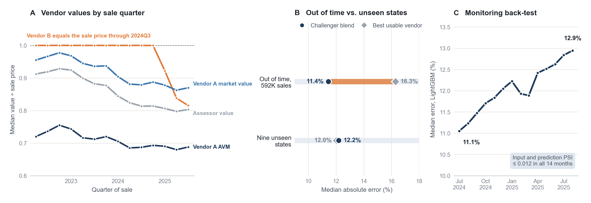

# The simpler prepayment model held up out of time. Its validation found where it breaks.

[](https://github.com/lyz44git/prepayment-and-avm-model-validation/actions/workflows/tests.yml)

**On 22.9 million property-months, a gradient-boosting challenger ranked home sales far better than an interpretable
logit in sample (AUC 0.704 against 0.650) and lost almost all of that edge out of time (0.642 against 0.639). The
validation behind that choice found a 26–30% shortfall in predicted refinancing, a house-price response too small to
use, and a vendor home value 32% below sale prices.**

When a homeowner sells or refinances, the mortgage is paid off early. How fast that happens drives the runoff and
value of a mortgage book, and in 2022–25 it changed sharply, as mortgage rates rose faster than at any time in 40
years. How far can a model of it be trusted out of time, in states it never saw, and under rate and house-price
shocks?

This repository builds such a model and validates it the way a model-risk review does: champion against challengers,
out-of-time and hold-out-state backtests, stress tests, a findings log, and a remediation run against closure rules
written down before any refit. A second study applies the same review to the home values that lenders buy from data
vendors, against 2.4 million recorded sale prices. Both use 348.9M rows of licensed property, deed, lien and
household records; every number below is read from an aggregate table in `reports/` and checked by a test.

**Scope.** The prepayment model is property-level: the loan at risk is not observed for homes that later sell or
refinance, so a sale or a new first lien stands in for prepayment. Nothing here is bank, servicer or credit-bureau
data. The validation is self-administered (the developer is also the validator), so it is not independent in the
SR 11-7 sense. What carries over is the method: deciding a champion on out-of-time evidence, and recording what the
backtest headline does not show.


**Figure 1. The champion, its out-of-time backtest, and the valuation comparison.** *Notes:* Panel A shows the AUC of the monthly sale hazard for the logit (champion) and monotone LightGBM (challenger) in the training months (2022-05 to 2024-06), out of time (2024-07 to 2025-06) and in nine hold-out states out of time; the number on the right is LightGBM minus logit. Panel B shows monthly pool CPR out of time: actual, the logit fixed at June 2024, and the logit recalibrated each month on the trailing three months of actual against predicted; the error is the mean absolute error in percentage points. Panel C shows the median absolute error of two vendor value fields, the hedonic baseline and the challengers, each on the out-of-time sales it covers (591,687 in all); vendor values are evaluated, never used as features.

## 1. The interpretable logit stayed champion: LightGBM's edge vanished out of time.


**Figure 2. Calibration and rate sensitivity of the champion.** *Notes:* Panel A shows predicted ÷ actual monthly hazard of the logit by split, for sales and for refinances or new first liens; 1 is perfect calibration. Panel B shows the predicted and actual share of 482,037 homes that sell or take a new first lien within 12 months of July 2024, by decile of predicted risk. Panel C shows the odds ratio of the monthly hazard per percentage point by which the market rate exceeds the rate when the home was bought (the lock-in gap), with 95% confidence intervals, for refinancing under six specifications and for sales under two.

Three models challenged each other: an actuarial lookup, a cause-specific discrete-time logit and LightGBM with
monotone constraints. In the training months LightGBM ranked sales far better (AUC 0.704 against 0.650). Out of time
the gap almost closed (0.642 against 0.639), and in hold-out states out of time it was gone, so the interpretable logit is the
champion ([report, §5](docs/prepayment_model_development_and_validation.md#5-results)).

The logit tracks monthly pool CPR out of time with a correlation of 0.90 and a mean absolute error of 0.43 points.
A flat forecast has about the same error (0.42) but does not track the pattern. Sales are calibrated in every split
(predicted ÷ actual 1.02 to 1.04 out of sample). Refinancing is not: it is under-predicted by 30% out of time and by
36% in hold-out states out of time (finding F2). The 12-month forecast ranks homes modestly (AUC 0.58; the top decile
terminates 1.45 times as often as average) and falls short in nine of ten deciles, the same refinance shortfall.

Refinancing falls as the lock-in gap widens: an odds ratio of 0.89 per point (95% CI 0.86 to 0.93), between 0.87
and 0.93 across tenure splines, sampling seeds and the two halves of the training window. The sale coefficient
changes sign with the tenure spline and is reported as not identified (F3). The logit was fitted on all events and
10% of non-events with a corrected intercept; refitting on all 13.1M training rows moved the six key coefficients by
less than 0.20 standard errors.

<sub><b>Methods.</b> 16,060,240 at-risk owner-occupied homes; a 4% random sample of 642,445 homes gives 22,885,356 property-months (2022-05 to 2025-06). Cause-specific discrete-time logit hazards for sale and for refinance or new first lien, on all events and 10% of non-events with King–Zeng intercept correction; an actuarial lookup and monotone LightGBM as challengers. Training in 41 jurisdictions to 2024-06; out of time 2024-07 to 2025-06; nine hold-out states, one per census division, fixed in advance. Pool CPR from summed monthly hazards.</sub>

## 2. Under stress, the model can be used only inside the rates it was trained on.


**Figure 3. Stress tests on 564,732 homes over 24 months.** *Notes:* Panel A shows the change in average 24-month CPR against a base with rates flat at the June 2025 level (6.82%), for the logit and LightGBM, under rate shocks phased in over six months and under the realised rate path; shaded rows end outside the 5.22–7.62% range of mortgage rates in the training months. Panel B shows the change under house-price shocks phased in over 12 months with rates flat, for the published logit (log appreciation and estimated LTV as equity terms) and the remediated one (estimated LTV only); the dashed line is the closure bar for the −10% shock, fixed in the remediation plan. Panel C shows the share of training property-months by estimated loan-to-value band.

With rates flat at June 2025 levels the pool prepays at 3.2% a year. A 200 bp cut raises that by 1.25 points and a
200 bp rise lowers it by 0.85, the usual asymmetry, produced by the refinance channel. Three of the four shocks end
outside the rates the models were trained on. There the challenger is flat by construction, since trees cannot
extrapolate, so at +200 bp its response is a fifth of the champion's (−0.18 against −0.85 points). The spread is
reported as model uncertainty (F10).

A 10% fall in house prices barely moves prepayment in the published model (−0.008 points), because two equity terms
built from the same index offset each other (F9). Keeping estimated LTV alone roughly doubles the response at no cost
in accuracy, but it stays far below the bar fixed in advance. The data explain why: the stress pool's median LTV is
0.30, and only 0.004% of training property-months are above 80% LTV, where a price fall would bite.

<sub><b>Methods.</b> Seven scenarios from the validation report and two house-price paths added by the remediation plan; homes rolled forward month by month along each path; count-based CPR. The house-price input is a repeat-sales index built from the same deeds and checked against the FHFA index.</sub>

## 3. The remediation ran against a plan fixed in advance. Neither finding closed.


**Figure 4. The refinance shortfall and what reduced the pool error.** *Notes:* Panel A shows predicted ÷ actual monthly refinance or new-lien hazard out of time for the remediated logit, fixed at June 2024 and re-estimated each month on data to t − 2; the band is the closure rule for F2 fixed in the plan. Panel B shows the mean absolute error of monthly pool CPR out of time, in percentage points, for the logit fixed and re-estimated, a flat forecast, the best rolling time-series benchmark, and the logit recalibrated on the trailing three months.

The plan, the candidate specifications and the closure rules were written and hashed before any model was refitted
([plan](docs/prepayment_model_remediation_plan.md); the hash is in `reports/p1/remediation/meta.json` and checked by
the tests). The run script recorded the hash when it started (plan saved 09:54, run 09:55): this shows the plan was
not edited afterwards, not when it was written. The run first reproduced the published model exactly (pool-CPR error
0.427, r = 0.900), chose among candidates on training months only, then scored the out-of-time window once.

- **House-price stress (F9).** Estimated LTV as the only equity term costs nothing in accuracy (out-of-time AUC
  within 0.001) and roughly doubles the response (−10%: −0.008 → −0.015 points; −20%: −0.023 → −0.030; +10%:
  +0.003 → +0.015). The bar was −0.05. **Not closed;** the model must not be used for house-price stress testing.
- **Refinance shortfall (F2).** No lagged-rate term improved the validation months. Re-estimating every month leaves
  predicted ÷ actual at 0.71, against a closure band of 0.90 to 1.10. A specification with 6- and 12-month rate
  changes would have reached 0.83 out of time (short of the 0.85 bar), but the validation months, which contain no
  rate dip, did not support it, so it is reported and not adopted. **Not closed.** Trailing three-month
  recalibration lowers the pool error from 0.43 to 0.30 points, and still to 0.30 (r = 0.85) when the data arrive
  two months late; it is the monitoring control.
- **Champion.** Outside the plan, the LTV-only specification is proposed as champion, since it is equally accurate
  and drops the offsetting equity terms. Sections 1 and 2 above, and §5–6 of the report, describe the published
  specification.

<sub><b>Methods.</b> SHA-256 of the plan recorded before any refit. Step 0 reproduces the published model. Five candidate specifications fitted on 2022-05 to 2023-12 and chosen on 2024-01 to 06; the out-of-time window scored once. Walk-forward refits on training-state rows dated t − 2 or earlier.</sub>

## 4. The vendor home values were the weak link. The challenger beat them out of time, not in unseen states.



**Figure 5. Vendor values, the challenger in unseen states, and the monitoring back-test.** *Notes:* Panel A shows the median ratio of each vendor value field to the recorded sale price, by quarter of sale, for 2.4 million arm's-length resales. Panel B shows the median absolute error of the challenger blend and of the best usable vendor value out of time (2024-07 to 2025-08) and in nine states the challengers never saw. Panel C shows the monthly median error of the LightGBM challenger out of time, and the largest population stability index (PSI) of its inputs and predictions in any month against the calibration window, leaving out features that shift by design.

Lenders use vendor home values as collateral and verification inputs. One vendor AVM sits 32% below sale prices
(median ratio 0.68, median error 34.4%) and does not track appreciation since 2022. Another vendor's "estimated
value" is anchored to the sale it should predict: its median error is under 0.3% for sales through 2024Q3, which is
target leakage, not a benchmark. A vendor-stated error field has no power to rank large errors (AUC 0.50)
([report](docs/avm_champion_challenger_validation.md#2-vendor-due-diligence-champions)).

Out of time the challenger blend has a median error of 11.4%, against 16.3% for the best usable vendor; on the
454,526 sales that have both Vendor A values, the county-cluster bootstrap difference is −5.4 points (95% CI −6.7 to
−4.4). In nine states it never saw, the blend does no better than that vendor (12.2% against 12.0%; difference +0.1,
95% CI −2.5 to +1.8).

Its 80% conformal intervals cover 77.5% of out-of-time sales. Over a 14-month monitoring back-test, input and
prediction PSI stayed at or below 0.012 while median error rose from 11.1% to 12.9%: drift monitoring on inputs would
not have caught the decay, so outcome-based error triggers are proposed. Within price tiers, the vendor AVM's ratio of
value to sale price is 9.1% lower in the tracts with the highest minority share than in the lowest, against 2.0% for
the challenger
([figure](reports/p2/fig4_disparity_within_tier.png)). The LightGBM challenger is packaged as a FastAPI scoring
service with a PSI drift endpoint and 19 tests ([`service/`](service)).

<sub><b>Methods.</b> 2,418,184 arm's-length resales (2022-05 to 2025-08, 49 states and DC); training to 2024-03, calibration 2024-04 to 06. Hedonic OLS, LightGBM on 33 features, a PyTorch neighbour-attention network over the 32 nearest comparable sales, and their equal-weight blend (added after calibration-window results, not test results). Split-conformal intervals; county-cluster bootstrap; PSI against the calibration window.</sub>

## 5. Seven of ten findings remain open.


**Figure 6. The findings log of the prepayment model.** *Notes:* Severity and status are read from the findings log in [§7 of the prepayment report](docs/prepayment_model_development_and_validation.md#7-findings-log), which also gives the evidence and remediation for each finding; the labels are shortened.

Each of the following fell short of a closure rule fixed before the refit.

- A −10% house-price shock lowers 24-month CPR by 0.015 points under the remediated model; the bar was 0.05 (F9).
- Out-of-time refinance predicted ÷ actual at fixed origin is 0.70; the bar was 0.85 (F2).
- Re-estimated monthly, it is 0.71 with a pool error of 0.43 points; the bar was 0.90 to 1.10 and 0.30 points (F2).

The other limits are recorded in the reports. The model is property-level, with no loan balances, so the cash-flow
pool is illustrative. Rate effects come from one rising-rate episode. The house-price index is built from the same
deeds and enters as a realised input, so forecasts are conditional. Vendor values carry look-ahead in the valuation
comparison, which favours the vendors on timing.

## The studies

| Study | Question | Report | Code |
|---|---|---|---|
| Prepayment hazard model | How fast do homes terminate their mortgage through sale or refinance in 2022–25, and how far can a model of it be trusted out of time, out of state and under stress? | [development and validation](docs/prepayment_model_development_and_validation.md) | `scripts/04`–`09`, `16`, `17`, `21`, `22` |
| Remediation of F2 and F9 | Can the two most consequential open findings be closed under rules fixed before any refit? | [plan](docs/prepayment_model_remediation_plan.md); §9 of the report | `scripts/31`–`33` |
| Home-valuation models | How accurate, current and even-handed are vendor home values against recorded sale prices, and can a challenger beat them out of time and out of geography? | [champion–challenger validation](docs/avm_champion_challenger_validation.md) | `scripts/10`–`15`, `23`, `24`; `service/` |

### Studies by method

| Method | Study |
|---|---|
| Discrete-time competing-risk hazards (cause-specific logit), case-control sampling with intercept correction | prepayment |
| Monotone gradient boosting (LightGBM) and actuarial-lookup challengers | prepayment |
| Out-of-time, hold-out-state and walk-forward backtests; pool CPR | prepayment, remediation |
| Time-series benchmarks (naive, seasonal naive, ARX) and trailing recalibration | prepayment |
| Rate and house-price stress tests; cash-flow valuation of a pool | prepayment |
| Repeat-sales house-price index, checked against FHFA | prepayment |
| Hedonic regression, LightGBM, PyTorch attention over comparable sales | valuation |
| Split-conformal intervals; county-cluster bootstrap | valuation |
| PSI drift monitoring; FastAPI scoring service | valuation |
| Within-tier valuation gap by tract minority share | valuation |
| Plan hashed before the run, findings log, closure rules | prepayment, remediation |

## Data sources and terms

| Data | Use | Terms |
|---|---|---|
| Licensed property, deed, lien and household records from three commercial vendors (Vendor A, B and C) | events, prices, property attributes, vendor value fields | Obtained for academic research under a data-use agreement. **Not redistributable.** The vendors are not named because the study reports findings about their products. |
| Freddie Mac PMMS, 10-year Treasury, unemployment, FHFA California HPI (FRED) | rates, stress paths, index check | Public; `scripts/00_download_fred.sh`. |
| Census tract attributes | density, owner share, median age | Public. |

No record-level data are in this repository. `reports/` holds aggregate tables only (no identifiers, no table with
more than 2,000 rows; a test checks this). The models were estimated on working tables without names or street
addresses (they do contain geocodes and tract IDs); owner-name comparisons were done inside the database and never
extracted. The extraction step that builds these tables from the licensed files is not published.

## Repository layout

```
docs/       the two validation reports and the remediation plan
reports/    aggregate tables and figures behind every number (p1 prepayment, p1/remediation, p2 valuation)
figures/    Figures 1 to 6, and the script and shared style that draw them from reports/
scripts/    numbered pipeline: panel, models, evaluation, stress, report figures, remediation
src/mval/   shared code: panel and logit design, metrics, amortization, fairness, valuation statistics
service/    FastAPI scoring service with PSI monitoring, and its tests
tests/      tests that run anywhere (CI)
```

## Setup

```bash
python -m venv .venv && source .venv/bin/activate
pip install -r service/requirements.txt scipy statsmodels matplotlib
python figures/make_figures.py
```

This is enough for the tests and Figures 1 to 6. The report figures in `reports/` redraw with `scripts/18`, `19` and
`33` after `scripts/00_download_fred.sh`. Scripts 04–17, 21–24 and 31–32 re-estimate everything from the licensed
working tables (`MVAL_WORK`) and cannot run from a clone (`requirements.txt` lists what they need); they are
published so the method can be read and reviewed line by line.

## Tests

```bash
pytest tests service/tests -q
```

The tests need none of the licensed data. They check that the hazard estimator recovers known coefficients on
simulated data, the metric and amortization arithmetic, every headline number in this README and the reports against
the tables in `reports/`, the hash of the remediation plan, that no table in `reports/` is large or carries an
identifier column, and the scoring service on a fixture model. One service test needs the real model and is skipped
in CI. They run on every push (see the badge above).

## License

Code in `src/`, `scripts/`, `figures/`, `service/` and `tests/` is released under the MIT License (see `LICENSE`).
Files in `reports/` and `docs/` are derived from licensed data and are shared for non-commercial research and review
only.

## Notes

Developed with an AI-assisted coding workflow. The research questions, analysis plans and interpretation of results
were led by the author. All results are reproducible from the scripts and the licensed working tables; the aggregate
tables behind every number are in `reports/`.
