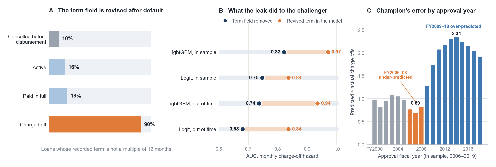
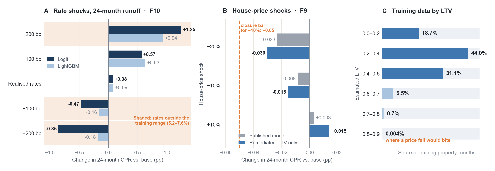
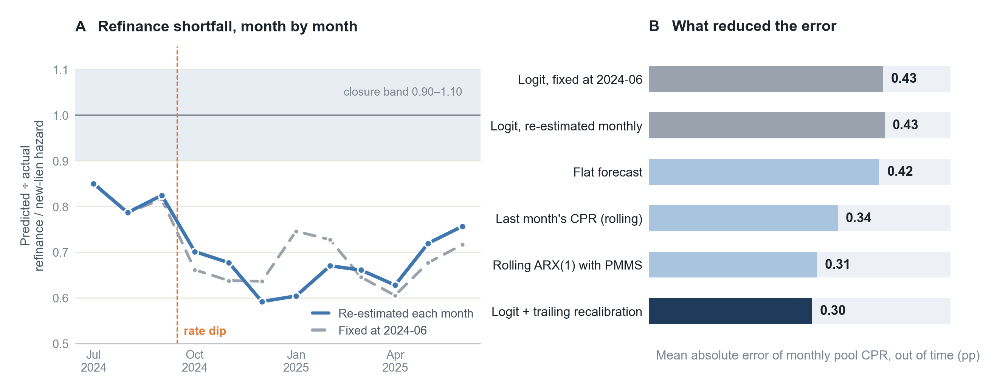
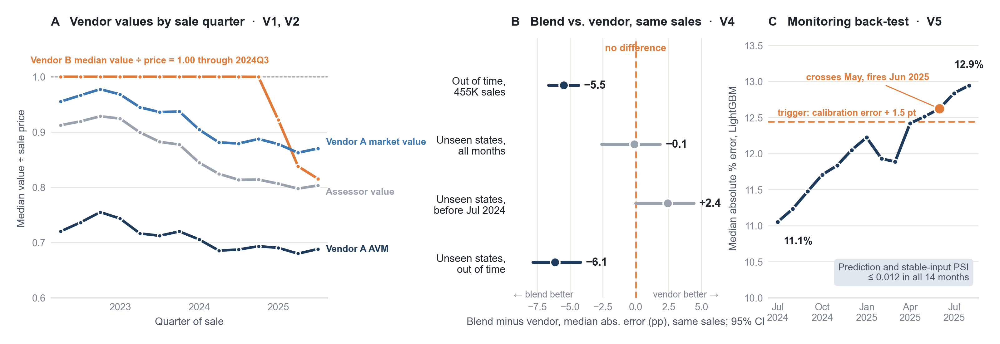

# Three models behind a lifetime loss estimate, and where each one breaks

[](https://github.com/lyz44git/prepayment-and-avm-model-validation/actions/workflows/tests.yml)

**A credit-loss allowance multiplies three model outputs: when a loan is written off and how much is lost, how long
it stays on the books, and what the collateral behind it is worth. Reviewed one by one, the loss model at first over-predicted
post-2019 charge-offs 2.8-fold, because it read safer loans as a better economy and because payment relief in
2020–21 broke the link to unemployment (three rounds of fixes cut the error, but no candidate met its pre-set rules),
the prepayment challenger's edge vanished out of time, and
one vendor's home values sat 32% below sale prices.**

An allowance for credit losses under CECL asks, for every loan on the books, how much will be lost over its life.
The answer multiplies three things a model has to supply: the timing and size of losses (credit loss), how long the
loan stays on the books before it is repaid (prepayment), and what the property behind it is worth (collateral
value). A model risk review asks the same question of each: under which conditions can the number be used, and what
would show that it has stopped working?

This repository builds one model of each kind and reviews it in the structure of a validation report: a champion
against challengers, out-of-time and hold-out tests, scenario or stress runs, a findings log, and fixes tested
against rules written down before they were run. The numbers below are read from aggregate tables in `reports/`, and
the headline ones are checked by tests.

**Scope.** The three studies use two datasets, so they review the three inputs separately rather than as one
pipeline. The credit-loss study uses public SBA 7(a) small-business loan records; the prepayment and valuation
studies use licensed U.S. property, deed, lien and household records, where prepayment is proxied by home sales and
refinances. None of it is bank, servicer or credit-bureau data. The validation is self-administered (the developer is
also the validator), so it is not independent in the SR 11-7 sense. What carries over is the method.

| Input to lifetime loss | Study | Data | Question a validator asks | Use limit found |
|---|---|---|---|---|
| When loans are written off, and how much is lost | Credit loss: charge-off hazard, severity, lifetime expected loss | SBA 7(a), 919,479 loans, 2006–2026 | Does the level hold out of time and under scenarios? | Lifetime losses only, fitted on a full cycle; report a range; not for 24-month forecasts |
| How long loans stay on the books | Prepayment: competing-risk hazard | Licensed records, 22.9M property-months, 2022–2025 | Does the champion hold out of time, out of state and under stress? | Sale side usable; refinance under-predicted; no house-price stress use |
| What the collateral is worth | Home valuation: vendor models vs. challengers | Licensed records, 2.4M sales, 2022–2025 | Are the vendor values accurate, current and even-handed? | Vendor values not usable as benchmarks; challenger not proven out of state |


**Figure 1. One headline result for each input.** *Notes:* Panel A shows predicted ÷ actual charge-off dollars over the 24 months after each December origin (2009–2023) for the book of SBA 7(a) loans at risk, from a logit refitted on the data to that date with the realised macro path; the shaded band is ±25%, the pass band fixed before the run. Panel B shows the AUC of the monthly sale hazard for the prepayment logit (champion) and monotone LightGBM (challenger) in the training months, out of time and in hold-out states out of time; the number on the right is LightGBM minus logit. Panel C shows the median absolute error of two vendor value fields, the hedonic baseline and the challengers, each on the out-of-time sales it covers (591,687 in all).

## 1. Credit loss: the champion confused safer loans with a better economy.



**Figure 2. What the data record, and what the champion gets wrong.** *Notes:* Panel A shows, by final loan status, the share of SBA 7(a) term loans whose recorded term is not a whole number of years; loans cancelled before disbursement keep their approved terms. Panel B shows the AUC of the monthly charge-off hazard for the logit and LightGBM, in sample (2006–2019) and out of time (2020-01 to 2026-09), with the revised term among the features (first fit) and without it. Panel C shows predicted ÷ actual charge-offs of the champion logit by approval fiscal year, in sample.

**The data first.** The loan's recorded term is revised after it runs into trouble: 90% of charged-off loans have a
term that is not a whole number of years, against 10% of loans cancelled before disbursement. With that field in
the model, LightGBM reached an out-of-time AUC of 0.935; without it, 0.737. The term is used for nothing but the
projection horizon. Payoff dates before mid-2005 are bulk-stamped, so the risk window starts in 2006, and charge-off
is an administrative write-off that comes about four years after disbursement, partly in batches of up to 1,935
loans a month ([report, §2](docs/credit_loss_cecl_validation.md#2-what-the-data-record)).

**The champion.** Three models compete for the monthly charge-off hazard: a lookup by loan age and program, a
cause-specific logit with an unemployment term (lag chosen on validation months) and LightGBM. LightGBM ranks loans
better (out-of-time AUC 0.737 against 0.681) but fails the calibration part of the pre-set challenger rule, so the
logit stays champion by default: it is no better calibrated (2.13 against 1.66 times actual in the validation months).
Every model over-predicts 2020–2026 charge-offs by more than two-fold (the champion 2.8-fold: 1.75-fold outside the
2020–21 relief months and 6.7-fold inside them).

**Why.** By approval year, the champion under-predicts the crisis cohorts of FY2006–07 (0.77 and 0.69) and
over-predicts every cohort from FY2009 to FY2018 (1.28–2.34). Its unemployment term was learned from one crisis whose
losses came from loans approved just before it. Adding approval-era effects halves the unemployment coefficient,
from 0.215 to 0.103: about half of what the model read as sensitivity to the economy was the quality of the loans on
the books.

<sub><b>Methods.</b> SBA 7(a) term loans, FY2000 onward, as of 2026-09-30: 919,479 loans and 52,141,481 loan-months at risk in 2006-01 to 2026-09 (115,117 charge-offs, 572,070 payoffs). Cause-specific discrete-time hazards for charge-off and payoff on all events and 5% of other months, intercept corrected; fit 2006–2017, validation 2018–2019, out of time 2020-01 to 2026-09; nine hold-out states. Plan hashed before fitting; six documented deviations, including the removal of the term and three remediation rounds (<a href="docs/credit_loss_deviations.md">deviations</a>).</sub>

## 2. Three rounds of fixes cut the forecast error by a third to a half, and no candidate met its pre-set rules.


**Figure 3. Backtests before and after remediation.** *Notes:* Panel A shows predicted ÷ actual 24-month charge-off dollars at eight December origins for the champion before remediation and for the logit with approval-era effects and the relief overlay, with and without trailing recalibration, each refitted on data to the origin and run with the realised macro path; the band is ±25%, the pass band fixed before the run. Panel B shows monthly charge-off dollars in 2020–2021 against forecasts made at December 2019; the shaded months are those in which SBA made borrowers' loan payments. Panel C shows predicted ÷ actual charge-off dollars of each origin's book from the origin to 2026-09, for the lookup, the champion and two remediated models.

A loss forecast conditioned on the economic path is the premise of a scenario-based allowance. At six of eight
origins, the champion's 24-month forecast with the realised path differs from the one with macro held at the origin
by less than 3% (in part mechanically: with the 12-month lag, the first 12 months use the same inputs). The path helped once, after the financial crisis, and hurt once: from December 2019 the champion
predicted 7.7 times the charge-offs of April 2020 to December 2021, because unemployment rose by nine points while
SBA made borrowers' loan payments ([report, §6–7](docs/credit_loss_cecl_validation.md#6-rolling-backtest-does-knowing-the-macro-path-help)).

Three rounds of fixes followed, each with its pass rule written down before it ran
([deviations D4–D6](docs/credit_loss_deviations.md)): approval-era effects, trailing recalibration, a term for loans
still in the default pipeline after a downturn, and a documented overlay that treats the payment-relief quarters as
absorbing the 2020 shock. Outside the relief months, out-of-time predicted ÷ actual moves from 1.75 to 0.72–0.83
across the candidates (0.81 for the era model with the overlay, 0.74 without it, because the overlay also shifts
2022–23 inputs). The best candidate halves the typical 24-month error (mean absolute log ratio 0.68 to 0.33); about
half of that gain is the 2019 origin, where the overlay uses hindsight about the relief programme and the forecast
falls from 7.2 to 1.6 times actual. Without that origin the error falls by a third (0.49 to 0.32). No candidate meets both
pre-set rules: the era model meets the out-of-time rule but is within ±25% at four of eight origins, and the best
backtest (five of eight, against six required) comes from a model at 0.73 out of time. Besides 2019, the remaining
misses alternate in sign at 2011, 2013 and 2015, when SBA wrote off crisis-era loans during an expansion, a schedule
no input at the origin can predict.

The allowance is a lifetime quantity, so the last round tested lifetime losses: did each origin's book eventually
lose what the model said? The pre-set rule (within ±25% at five of six origins) is not met: the best candidate
reaches four. Fitted on four to eight years (2009–2013 origins), the logit models under-predict in all 12 cases, in
11 by more than 30%. At the three latest origins the three candidates are within ±25% of losses to date (0.94–1.22),
where the champion overstates them 1.8–2.5 times; that pattern was seen after the fact, the three books overlap,
and every run uses the overlay. Without the overlay the counts are the same and the three candidates stay within ±25% at the three
latest origins (0.87–1.21), so the pattern does not come from the overlay. The finding stays open and the disposition is research use only. The
recommendation, outside the rules and labelled as such, is to fit on a full credit cycle and report a range. Drift
statistics did not flag the 2017 error: between the 2015 and 2017 origins the book's PSI was 0.02 while the 2017
forecast turned out 2.3 times actual.

<sub><b>Methods.</b> Origins every December from 2009 to 2023; models refitted on all data to each origin; projection of each loan month by month with both hazards and the severity model; actual charge-offs from the loan records. Lifetime test: the book at each origin projected to 2026-09 (81 to 201 months of outcomes).</sub>

## 3. Which model you choose still moves the allowance more than the Fed's severe scenario does.


**Figure 4. Lifetime expected loss of the active book at 2026-09-30.** *Notes:* Panel A shows lifetime expected loss as a share of the estimated outstanding balance of the 232,292 loans active at 2026-09-30 ($128bn) under the Federal Reserve's 2026 supervisory baseline and severely adverse scenarios, for the three candidate models and the champion (all with the relief overlay in their estimation history), LightGBM and the lookup (no macro terms). Panel B shows the unemployment rate in the two scenarios, applied from their 2026Q1 start, with straight-line reversion to the 2006–2025 average after 2029Q1. Panel C shows charge-off dollars over original loan amounts by year of charge-off.

The candidate models put lifetime loss (gross write-offs, before recoveries) at 3.4% to 4.4% of balance under the Fed
baseline, against 6.0% for the champion with the same overlay (5.7% as first fitted); the severely adverse scenario
adds 0.1 to 0.8 points to them and 2.5 points to the champion. The spread
between reasonable models is still at least as large as the spread between scenarios, and how much the scenario
matters depends on which model is used. Severity moves little with the cycle (charge-off dollars over original amount
0.58–0.70 a year; the severity model is within 2% of actual dollars out of time), so the scenario effect comes almost
entirely from the hazard. The usable statement is a range with its reasons, not one model's number
([report, §9 and §11](docs/credit_loss_cecl_validation.md#11-remediation-three-rounds-each-with-its-rule-written-before-it-ran)).

<sub><b>Methods.</b> Final models fitted on 2006-01 to 2026-09. Horizon: each loan's remaining recorded term (sensitivity: 24 more months, +0.25 to +0.47 points before remediation). Expected loss = survival × charge-off hazard × severity × original amount; the lender's retained share is pro rata to the unguaranteed part.</sub>

## 4. Prepayment: the simpler model held up out of time; its refinance forecast did not.


**Figure 5. Calibration and rate sensitivity of the prepayment champion.** *Notes:* Panel A shows predicted ÷ actual monthly hazard of the logit by split, for sales and for refinances or new first liens; 1 is perfect calibration. Panel B shows the predicted and actual share of 482,037 homes that sell or take a new first lien within 12 months of July 2024, by decile of predicted risk. Panel C shows the odds ratio of the monthly hazard per percentage point by which the market rate exceeds the rate when the home was bought (the lock-in gap), with 95% confidence intervals, for refinancing under six specifications and for sales under two.

Three models challenged each other: an actuarial lookup, a cause-specific discrete-time logit and LightGBM with
monotone constraints. In the training months LightGBM ranked sales far better (AUC 0.704 against 0.650). Out of time
the gap almost closed (0.642 against 0.639), and in hold-out states out of time it was gone, so the interpretable
logit is the champion ([report, §5](docs/prepayment_model_development_and_validation.md#5-results)). It tracks
monthly pool CPR out of time with a correlation of 0.90 and a mean absolute error of 0.43 points. Neither is
distinctive: a seasonal-naive forecast has the same correlation (0.90) and a flat forecast about the same error
(0.42), so the model's value is in the loan-level ranking and the stress response, not the pool forecast. Sales are calibrated in every split (predicted ÷ actual
1.02 to 1.04 out of sample); refinancing is under-predicted by 30% out of time and by 36% in hold-out states out of
time. Refinancing falls as the lock-in gap widens (odds ratio 0.89 per point, 95% CI 0.86 to 0.93; between 0.87 and
0.93 in five of six specifications and 0.98, not significant, with a cohort-rate proxy); the sale coefficient changes sign with the tenure spline and is reported as not
identified.

<sub><b>Methods.</b> 16,060,240 at-risk owner-occupied homes; a 4% random sample of 642,445 homes gives 22,885,356 property-months (2022-05 to 2025-06). Cause-specific discrete-time logit hazards for sale and for refinance or new first lien, on all events and 10% of non-events with King–Zeng intercept correction; refitting on all 13.1M training rows moved the six key coefficients by less than 0.20 standard errors. Training in 41 jurisdictions to 2024-06; out of time 2024-07 to 2025-06; nine hold-out states fixed in advance.</sub>

## 5. Under stress the prepayment model is usable only inside its training rates, and two findings stayed open after remediation.



**Figure 6. Stress tests on 564,732 homes over 24 months.** *Notes:* Panel A shows the change in average 24-month CPR against a base with rates flat at the June 2025 level (6.82%), for the logit and LightGBM, under rate shocks phased in over six months and under the realised rate path; shaded rows end outside the 5.22–7.62% range of mortgage rates in the training months. Panel B shows the change under house-price shocks for the published logit (two equity terms) and the remediated one (estimated LTV only); the dashed line is the closure bar fixed in the remediation plan. Panel C shows the share of training property-months by estimated loan-to-value band.



**Figure 7. The refinance shortfall and what reduced the pool error.** *Notes:* Panel A shows predicted ÷ actual monthly refinance or new-lien hazard out of time for the remediated logit, fixed at June 2024 and re-estimated each month on data to t − 2; the band is the closure rule fixed in the plan. Panel B shows the mean absolute error of monthly pool CPR out of time, in percentage points, for five forecasts.

A 200 bp cut raises the pool's prepayment rate by 1.25 points and a 200 bp rise lowers it by 0.85. Three of the
four shocks end outside the rates the models were trained on; there LightGBM is flat by construction, so at +200 bp
its response is a fifth of the champion's (−0.18 against −0.85 points). A 10% fall in house prices barely moves
prepayment (−0.008 points) because two equity terms offset each other.

A remediation plan with closure rules was written and hashed before any refit
([plan](docs/prepayment_model_remediation_plan.md); the run recorded the hash when it started, which shows the plan
was not edited afterwards, not when it was written). Estimated LTV as the only equity term roughly doubles the
house-price response at no accuracy cost but stays far below the bar, because the stress pool's median LTV is 0.30
and only 0.004% of training property-months are above 80% LTV. Re-estimating every month leaves refinance
predicted ÷ actual at 0.71. **Neither finding closed.** Trailing three-month recalibration lowers the pool error from
0.43 to 0.30 points (0.30 with data two months late) and is kept as the monitoring control.

<sub><b>Methods.</b> Seven scenarios from the validation report plus two house-price paths from the remediation plan; homes rolled forward month by month; count-based CPR. Remediation: reproduction of the published model, five candidates chosen on training months only, one scoring of the out-of-time window, walk-forward refits on data to t − 2.</sub>

## 6. Collateral: the vendor values were the weak link.



**Figure 8. Vendor values, the challenger in unseen states, and the monitoring back-test.** *Notes:* Panel A shows the median ratio of each vendor value field to the recorded sale price, by quarter of sale, for 2.4 million arm's-length resales. Panel B shows the median absolute error of the challenger blend and of the best usable vendor value out of time (2024-07 to 2025-08) and in nine states the challengers never saw. Panel C shows the monthly median error of the LightGBM challenger out of time, and the largest population stability index of its inputs and predictions in any month, leaving out features that shift by design.

Lenders use vendor home values as collateral and verification inputs. One vendor AVM sits 32% below sale prices
(median ratio 0.68, median error 34.4%); another vendor's "estimated
value" is anchored to the sale it should predict (median error under 0.3% for sales through 2024Q3), which is target
leakage, the same kind of finding as the revised loan term in section 1
([report](docs/avm_champion_challenger_validation.md#2-vendor-due-diligence-champions)). Out of time the challenger
blend has a median error of 11.4% against 16.3% for the best usable vendor (on the sales both cover, a county-cluster
bootstrap difference of −5.4 points, 95% CI −6.7 to −4.4); in nine states it never saw it does no better (12.2% against 12.0%). The 80%
split-conformal intervals of the LightGBM challenger cover 77.5% of out-of-time sales. Over a 14-month monitoring
back-test, PSI of its predictions and of the inputs not expected to shift stayed at or below 0.012 while its median
error rose from 11.1% to 12.9%, the same blind spot as in section 2. Within price tiers, the vendor AVM's
value-to-price ratio is 0.09 log points (about 9%) lower in the tracts with the highest minority share than in the
lowest, against 0.02 for the challenger. The LightGBM challenger is packaged as a FastAPI scoring service with
a PSI endpoint and 19 tests ([`service/`](service)).

<sub><b>Methods.</b> 2,418,184 arm's-length resales (2022-05 to 2025-08, 49 states and DC); training to 2024-03, calibration 2024-04 to 06. Hedonic OLS, LightGBM on 33 features, a PyTorch neighbour-attention network over the 32 nearest comparable sales, and their equal-weight blend (added after calibration-window results). Split-conformal intervals (tree count early-stopped on the calibration window, which weakens the coverage guarantee); county-cluster bootstrap; PSI against the training window, excluding six inputs that shift by design.</sub>

## 7. Twenty-two findings, sixteen still open: the use limits.


**Figure 9. Findings logs of the credit-loss and prepayment models.** *Notes:* Severity and status are read from the findings logs of the two reports ([credit loss, §12](docs/credit_loss_cecl_validation.md#12-findings-log); [prepayment, §7](docs/prepayment_model_development_and_validation.md#7-findings-log)), which give the evidence and remediation for each finding; the labels are shortened.

Each of the following fell short of a rule fixed before the result was seen.

- Credit loss: after three rounds of fixes, no model's 24-month forecasts are within ±25% of actual at six of eight
  origins (best: five), and none is within ±25% of lifetime losses at five of six origins (best: four).
- Prepayment: a −10% house-price shock lowers 24-month CPR by 0.015 points under the remediated model; the bar was
  0.05.
- Prepayment: refinance predicted ÷ actual is 0.70 at fixed origin (bar 0.85) and 0.71 re-estimated monthly (bar
  0.90 to 1.10, with a pool error at or below 0.30 points; it is 0.43).

What follows for use:

- **Report the allowance as a range across models**, with the cohort effect and the macro term's share of it stated,
  rather than one model's number, and fit it on at least one full credit cycle (credit loss L2, L5, L10).
- **Switch off or overlay macro terms when policy changes borrowers' payments**, as in 2020–21 (L3).
- **Monitor outcomes, not only drift.** In both the loss and the valuation studies the drift statistics stayed
  quiet while errors grew (L6; valuation monitoring back-test).
- **Check that every field was known at decision time.** A revised loan term and a vendor value anchored to the
  sale price both looked like strong predictors (L1; valuation vendor due diligence).
- **Keep stress use inside the training range**, and do not use the prepayment model for house-price stress (F9,
  F10).

## The studies

| Study | Question | Report | Code |
|---|---|---|---|
| Credit loss and lifetime expected loss | When are small-business loans written off, how much is lost, and does a scenario-based lifetime loss estimate hold up out of time? | [validation report](docs/credit_loss_cecl_validation.md), [plan](docs/credit_loss_plan.md), [deviations](docs/credit_loss_deviations.md) | `scripts/40`–`47` |
| Prepayment hazard model | How fast do homes terminate their mortgage through sale or refinance in 2022–25, and how far can a model of it be trusted out of time, out of state and under stress? | [development and validation](docs/prepayment_model_development_and_validation.md) | `scripts/04`–`09`, `16`, `17`, `21`, `22` |
| Remediation of two prepayment findings | Can the two most consequential open findings be closed under rules fixed before any refit? | [plan](docs/prepayment_model_remediation_plan.md); §9 of the report | `scripts/31`–`33` |
| Home-valuation models | How accurate, current and even-handed are vendor home values against recorded sale prices, and can a challenger beat them out of time and out of geography? | [champion–challenger validation](docs/avm_champion_challenger_validation.md) | `scripts/10`–`15`, `23`, `24`; `service/` |

## Data sources and terms

| Data | Use | Terms |
|---|---|---|
| SBA 7(a) FOIA loan files as of 2026-09-30 (FY2000 onward) | credit-loss study | U.S. Government Works. Downloaded by `scripts/00_download_sba.sh` and checked against `reports/p3/SHA256SUMS.txt`; SBA replaces the files each quarter. |
| Federal Reserve 2026 supervisory scenarios (historic, baseline, severely adverse) | macro inputs of the credit-loss study | Public; same script. |
| Licensed property, deed, lien and household records from three commercial vendors (Vendor A, B and C) | prepayment and valuation studies | Obtained for academic research under a data-use agreement. **No data are published and none can be redistributed**; only code and aggregate results are shown, for research use. The vendors are not named because the studies report findings about their products. |
| Freddie Mac PMMS, 10-year Treasury, unemployment, FHFA California HPI (FRED); Census tract attributes | prepayment and valuation studies | Public; `scripts/00_download_fred.sh`. |

**Research use only, not commercial.** No record-level data are in this repository. `reports/` holds aggregate tables only (no identifiers, no table with
more than 2,000 rows; a test checks this). The SBA files name borrowers; their names and addresses are dropped when
the loan table is built and never leave the working folder. The licensed records were modelled on working tables
without names or street addresses; the step that builds them is not published.

## Repository layout

```
docs/       the three validation reports, the two analysis plans and the credit-loss deviations
reports/    aggregate tables and figures behind every number (p3 credit loss, p1 prepayment, p1/remediation, p2 valuation)
figures/    Figures 1 to 9, and the script and shared style that draw them from reports/
scripts/    numbered pipeline: 04-24 prepayment and valuation, 31-33 remediation, 40-47 credit loss
src/mval/   shared code: hazard designs, metrics, amortization, macro inputs, fairness, valuation statistics
service/    FastAPI scoring service with PSI monitoring, and its tests
tests/      tests that run anywhere (CI)
```

## Setup

```bash
python -m venv .venv && source .venv/bin/activate
pip install -r service/requirements.txt scipy statsmodels matplotlib
python figures/make_figures.py
```

This is enough for the tests and Figures 1 to 9. The credit-loss study reruns end to end from public data:
`scripts/00_download_sba.sh`, then scripts 40 to 47 in order (`requirements.txt` lists the packages; about two hours on
a 32-core machine). Scripts 04–17, 21–24 and 31–32 re-estimate the prepayment and valuation studies from the
licensed working tables (`MVAL_WORK`) and cannot run from a clone; they are published so the method can be read and
reviewed line by line.

## Tests

```bash
pytest tests service/tests -q
```

The tests need none of the data. They check the headline numbers in this README and the three reports against
the tables in `reports/`, the hashes of the two analysis plans, that the hazard estimator recovers known coefficients
on simulated data, the amortization, macro-reversion and metric arithmetic, that no table in `reports/` is large or
carries an identifier column, and the scoring service on a fixture model. One service test needs the real model and
is skipped in CI. They run on every push (see the badge above).

## License

Code in `src/`, `scripts/`, `figures/`, `service/` and `tests/` is released under the MIT License (see `LICENSE`).
Files in `reports/p1/`, `reports/p2/` and the prepayment and valuation reports are derived from licensed data and are
shared for non-commercial research and review only; the credit-loss tables derive from public SBA data.

## Notes

Developed with an AI-assisted coding workflow. The research questions, analysis plans and interpretation of results
were led by the author. All results are reproducible from the scripts, the public data and the licensed working
tables; the aggregate tables behind every number are in `reports/`.
